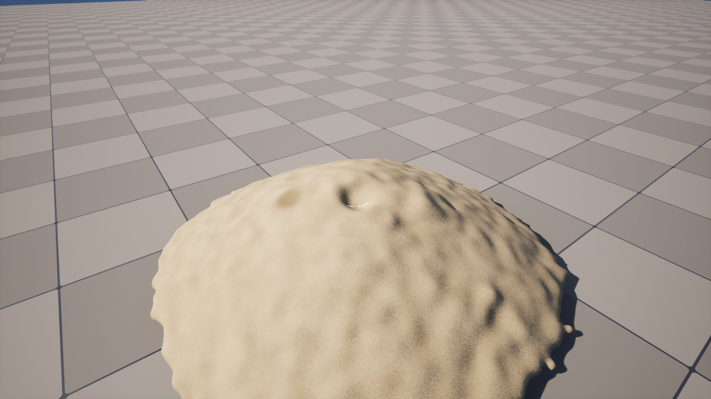

# M2 실행 기록

> 계획: [m2-plan.md](m2-plan.md). 시험 명령 (GPU 메시 대조):
> `UnrealEditor-Cmd.exe <uproject> -run=SpikeSweep -mesh -meshframe -AllowCommandletRendering -knramp=8 -isofrac=0.25 -cell=1.25 -bandr=7.5 -smooth=25 -scene=pour -count=3000 -frames=180 -every=60 [-pool=2] [-killhalf | -removehalf]`

## 실행 #1 — T1 입자 풀 · 죽은 칸 (2026-10-27)
- 방식: 죽은 입자는 번호를 그대로 두고 **무덤 자리**(`SandPool::GravePos`, z = 10⁶, 칸마다 50cm 떨어짐)에 고정 (w = 0). 셰이더는 고치지 않았다 — 위치만으로 이웃 · 지면 · 벽 · 메시 영역에서 빠진다.
  - `FSandSpike::KillParticles` (걸린 결합 삭제, 쌍 목록 워밍 유지) · `ReservePool(용량)` (죽은 칸 덧붙임) · `NumAlive` · `IsDead`.
  - CPU 메셔 `FSandSurfaceBuilder::Build` 는 무덤을 빼고 짓는다 (경계 상자). 입자당 대조 배열은 뺀 뒤 번호.
- 결과 (부어 쌓은 블록 3천, 벽 치운 뒤 180 프레임):

| 장면 | 칸 / 산 입자 | 메시 CPU = GPU | 정점 f180 | 최고점 | 시뮬 ms 평균 |
|---|---|---|---|---|---|
| 기준 | 3289 / 3289 | 3/3 | 38538 | 40.4 | 5.09 |
| 풀 ×2 | 6578 / 3289 | 3/3 | 38406 | 39.6 | 5.14 |
| 풀 ×2 + 반 죽임 | 6578 / 1799 | 3/3 | 26628 | 31.4 | 4.75 |
| 반 압축 제거 (대조) | 1794 / 1794 | 3/3 | 26073 | 31.9 | 4.62 |

- 풀 ×2 의 비용 +0.05 ms (죽은 칸은 이웃이 없어 바로 끝난다). 죽임 = 압축 제거와 같은 모양 (정점 2% · 최고점 0.5cm 차 — GPU 시뮬은 실행마다 조금 다르다, M1 #29 참고).
- 남은 것: T2 에서 GPU 쪽에서 직접 죽이기 (지금 `KillParticles` 는 CPU 전량 내려받기 · 올리기).

## 실행 #2 — T2 도구 스탬프: 파기 · 물붓기 (2026-10-27)
- `SandTool.usf` — 스텝 맨 앞 (패스 0):
  - `StampCS` (입자별): 임시 배수 이완 → 스탬프 순서대로. **파기** = 세기 확률로 손 재고(`HandW`, W 같이)에 넣고 무덤으로 · 손이 차면 못 판다. **물붓기** = W += 증가·(1 − d²/r²) (상한 1), 아래로 충격 속도.
  - `BondToolCS` (결합별): 무덤 간 입자의 결합 끊기 · 입자별 W 모드면 쌍 cohesion 을 W 에서 다시 → W ≥ 0.9 과포화면 0 이 되어 `BreakBondsCS` 가 끊는다.
  - CPU: `FSandToolStamp` · `QueueStamp` (물붓기는 입자별 W 모드로 전환) · `GetHandCount`. 내려받기에 W 추가, 무덤 위치로 Dead · 역질량 0 을 다시 맞춘다.
- 시험 (`-dig=30` 꼭대기 가운데를 20 프레임 판다, 반지름 12cm · 세기 0.3):
  - **산 입자 + 손 = 3289 가 매 프레임 그대로** (판 수 3~12/프레임, 20 프레임에 128 개). 메시 CPU = GPU.
- 시험 (`-pour=1` x < 가운데 반을 작은 구로 채워 적심, 젖은 입자 1390 · 평균 W 0.19):

| | 결합 | 왼쪽(젖힘) 높이 f180 | 오른쪽(마름) |
|---|---|---|---|
| 붓기 + 결합 생성 | 5026 → 3081 | **46.3** | 41.7 |
| 붓기, 결합 없음 | 0 | 40.0 | 39.2 |
| 붓기 + 결합 + 충격 150 cm/s | 5036 → 3022 | 46.9 | 37.8 |

  - 적신 쪽만 더 높이 남는다 (70cm 블록은 젖어도 버티는 높이를 넘어 양쪽 다 무너진다 — M1 W3 와 같음). **결합이 없으면 W 만 올려도 차이가 없다** → 물다리 = 결합 생성이 필요하다.
- **결정 필요**: 물을 부으면 닿은 쌍에 결합이 생기는 것이 물리에 맞다 (닿은 곳에 액체 다리). 지금은 붓기 끝에 CPU `FormBonds` (전량 내려받기 · O(N²) · 올리기, 3천 개는 무시할 만). 입자가 많아지면 GPU 결합 생성이 필요 — 쌓기(T3)도 같은 것을 쓴다.
- 고친 것: RDG `QueueBufferUpload` 의 `NoCopy` 를 지역 배열에 쓰면 실행 전에 사라진다 (스탬프 쓰레기값) → `None`. HLSL 한 줄 여러 선언은 UE 매개변수 파서가 못 읽는다.

## 실행 #3 — 사건 결합 생성 (결정 A, papers C17) (2026-10-27)
- 결정 (사용자): 결합은 **사건 때만** 생긴다 — 물붓기로 젖음이 오른 입자 · 쌓아 누른 입자. 움직이다 닿는다고 저절로 다시 붙지 않는다 (m0-spike ① 유지).
- 생성 기준 = 문헌 (Mani 2012 · Roy 2018): 닿음 (거리 < D·BondFormStretch) · 양쪽 W > W_dry · 쌍 cohesion > 0 · 입자당 슬롯 12.
- GPU (`SandTool.usf`): 스탬프가 `BondTrig` 표시 → 파단 뒤 `BondSlotCountCS` · `BondFormCS` (이번 프레임 쌍 목록, 원자 덧붙임) · 슬롯 수 스캔 → `BondAdjOffset` · `BondFillCS` (인접 목록 재작성, 죽은 결합 빠짐). 결합 용량 = 입자 × 6. CPU 는 결합 IJ 까지 내려받아 산 것만 추린다 (다시 올릴 때 압축).
- 시험 (`-pour=1`, 왼쪽 반 적심):

| | 생성 결합 | 왼쪽(젖힘) f180 | 오른쪽(마름) |
|---|---|---|---|
| GPU 사건 결합 | 4485 | 47.6 | 41.3 |
| GPU 사건 + CPU 전체 FormBonds | 4499 + 513 | 46.4 | 41.2 |
| (#2) CPU 전체 FormBonds 만 | 5026 | 46.3 | 41.7 |

  - GPU 가 쌍 목록(탐색 반경 안)만 보므로 CPU 전수 검사보다 1 할 적다 — 남은 513 개는 반경 가장자리 쌍. 결과 높이는 같은 범위.
  - ⚠ 같은 조건 재실행에서 왼쪽 42.3 / 오른쪽 41.9 도 나왔다 — 70cm 블록 붕괴는 실행마다 크게 달라진다 (GPU 비결정). 젖음 효과 판정은 버티는 높이(H_c 아래) 장면이나 여러 번 평균으로 해야 한다 → T3 에서.
- 파기 회귀: 산 입자 + 손 = 3289 그대로.
- 남은 것: 죽은 결합 칸은 GPU 에서 압축하지 않는다 (CPU 가 다시 올릴 때만). 오래 놀면 용량(입자 × 6)에 닿을 수 있다 → 넘침 계수 `BondFormRejected` 로 지켜본다.

## 실행 #4 — T3 손 재고에서 쌓기 (2026-10-27)
- `ESandTool::Pile` 스탬프 (Center = 바닥 가운데, Radius = 원기둥 반지름, Strength = 놓을 수). CPU 가 놓을 자리를 만든다: 원기둥 안 육각 격자, 층마다 어긋남, 간격 1.02 D · 지터 ±0.03 D (겹치지 않고 닿게).
- GPU (`SandTool.usf`): `PileCS` — 무덤 칸이 원자 계수로 차례를 받아 손 재고를 **뒤에서부터** (손 위 모래) 하나씩 꺼낸다. 자리 · W 같이 · 속도 0 · `BondTrig` 표시 → 같은 프레임 사건 결합 (#3). `PileFinishCS` 가 재고에서 쌓은 수를 뺀다. 파기 뒤에 돌아 같은 프레임에 판 것도 쌓을 수 있다.
- CPU `SyncFromGpu`: 무덤에서 돌아온 칸은 역질량 1 로 되돌린다.
- 시험 (`-scene=pour -count=3000`, f150 에 가운데를 반지름 15cm · 세기 1 로 20 프레임 파기 → f200 에 블록 오른쪽 90cm 바닥에 반지름 8cm 원기둥으로 200 개 쌓기. 젖음 = f100 에 블록 전체 물붓기 `-pourfull`):

| | 사건 결합 | 더미 높이 f380 (1회) | (2회) |
|---|---|---|---|
| 마름 | 0 | 13.1 cm | 14.0 cm |
| 젖음 | 783 | **24.6 cm** | **21.1 cm** |

  - 젖은 모래가 1.5~1.9 배 높이 선다 (사용자 기대와 같은 방향). 반복 차이는 젖음 쪽이 더 크다 (3.5cm).
  - **산 입자 + 손 = 3289 매 프레임 일정** (파기 · 쌓기 · 손에 남은 것 모두).
  - 쌓은 직후 놓은 원기둥은 높다 (80~120cm) — 30 프레임 안에 무너져 더미가 된다. 실제 브러시(T4)는 한 번에 적게 · 커서 위에 놓는다.
- 남은 것: 놓을 자리에 이미 모래가 있으면 겹친다 (지금은 빈 바닥 시험). T4 커서 픽킹에서 표면 위로 놓는다.

## 실행 #5 — T4 플레이 맵 · 커서 · 연속 브러시 (2026-10-27)
- `USandPlaySubsystem` (`Play/SandPlay.*`) — `-game -sandplay` 로 띄운다. 넓은 부은 블록 (기본 2만 개, 반 폭 80cm) → 벽 치움.
  - 조작: 좌클릭 파기 · 우클릭 쌓기 (손 재고에서, 프레임당 4 개) · F 물붓기 (프레임당 W +0.02) · 휠 반지름 3~40cm · Shift ×3 · 가운데 끌기 둘러보기 · WASD QE 이동.
  - 화면 위: 손 재고 / 용량 · 산 입자 · 합 · GPU ms. 커서 자리에 브러시 원 (도구 색).
- 커서 픽킹: 입자 높이장 (2cm 칸, 칸마다 알갱이 윗면 최대) 광선 행진 + 이분법. 높이장은 4 프레임마다 위치를 동기로 내려받아 다시 짓는다 — **비동기 리드백은 T5 비용을 보고 정한다**.
- 자동 시험 (`-sandplayshot=`): 카메라 앞 표면 세 곳에 파기 60 → 물붓기 40 → 쌓기 120 프레임. 픽킹 매 프레임 명중, **산 + 손 = 21225 일정**, 판 37 개를 전부 다시 쌓음, 물붓기 결합 41 개.

- 파기 세기 0.05 는 약해 (60 프레임 37 개) 0.15 로 올렸다.
- **손맛 · 지연 판정은 사용자** — `UnrealEditor.exe BeachSimulator.uproject /Game/1 -game -windowed -resx=1600 -resy=900 -sandplay`
