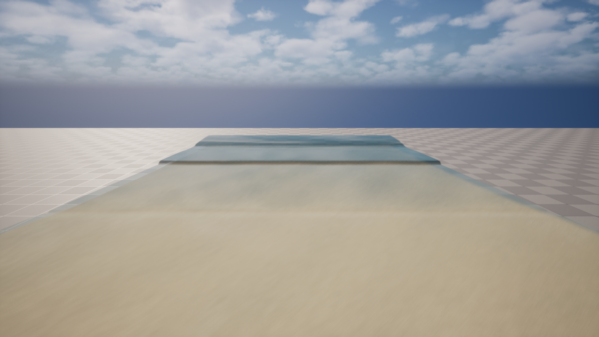
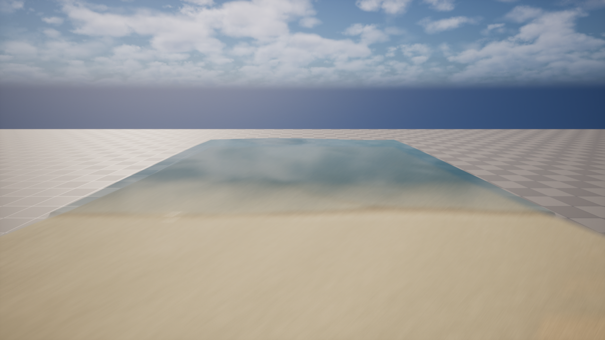

# M3 실행 기록 — 격자 시뮬

> 계획 [m3-plan.md](m3-plan.md) · 근거 [papers.md](../research/papers.md) D-M3.

## 실행 #1 — T1 KP07 CPU 기준판 (2026-10-28 밤, 계획 확인 전 선행)
- `Grid/SandGridCpu.*` — Kurganov & Petrova 2007 2D central-upwind (minmod θ 1.3 · 경계 수면 보정 2.15/2.16 · 재구성 점 속도 특이점 제거 2.17 · 경사 원천 2.10 · SSP-RK2 · CFL 1/4 · 벽 경계). double. `Grid/SandGridTest.cpp` — `-run=SpikeSweep -gridtest`.
- m3-plan 의 방향 변경(RDG · KP07 · Exner)은 **사용자 확인 전** — 어느 쪽으로 정해도 쓰이는 CPU 정답지 · 검증만 했다.

| 시험 | 결과 | 기준 |
|---|---|---|
| ① 정지 수면 (모두 잠김, 울퉁불퉁 바닥) | 최대 속력 **1.8e-15** m/s · 부피 1e-15 | \|u\| < 1e-6 ✓ |
| ② 마른 경사로 댐 붕괴 | 부피 변화 1e-16 · 최소 수심 0 · NaN 없음 | ✓ |
| ③ Synolakis 비쇄파 H/d 0.0185, 1:19.85 | R/d **0.0820** / 법칙 0.0861 = **0.953** (Δx 0.05) · 0.860 (Δx 0.1) — 해상도 따라 수렴 | ±10% ✓ |
| ③ 쇄파 H/d 0.3 | R/d 0.565 · NaN · 음수 수심 없음 (법칙은 비쇄파 전용 — 실험값과 비교 남음) | 안정 ✓ |
| ① **섬이 있는 정지 수면** (물 위로 나온 섬 — 해변에는 늘 물가가 있다) | **가짜 흐름**: 1mm 넘는 물에서 최대 0.21 m/s 가 남고, 얇은 막에서 수백 m/s 까지 자란다 | ✗ |

- **물가 가짜 흐름 = KP07 의 알려진 한계** (Bollermann, Chen, Kurganov, Noelle 2013, J. Sci. Comput. 56:267–290, arXiv 1412.3580 ✓): 수심이 음수가 안 되게 경계 수면을 지형에 맞추면 양쪽 경계 수면이 어긋나 정지 수면이 깨진다. 그 논문의 시험에서 KP07 오차 ~8e-5, 새 재구성은 1e-16.
- 시도한 것 (모두 `-gridtest` 옵션으로 남김):

| 방법 | 섬 가짜 흐름 (1mm↑) | 처오름 비 (Δx 0.05) |
|---|---|---|
| 기본 (KP07 그대로 + h < 0.1mm 운동량 0) | 0.21 m/s (얇은 막은 폭주) | **0.953** |
| 칸 평균에도 (2.17), ε^¼ = Δx | **0.005 m/s, 안 자람** | 0.624 ✗ (처오름 혀 감속) |
| 같은, ε^¼ = 1cm / 3mm | 0.49 / 0.92 | 0.813 / 0.955 |
| Manning 마찰 n 0.01 / 0.025 | 0.12 / 0.09 | 0.867 / 0.711 |

  → ε 조정 · 마찰로는 둘을 같이 못 잡는다. **다음: Bollermann 2013 젖음/마름 재구성** (일부만 잠긴 칸에서 수면을 평평하게 다시 짓고 · 마르는 칸의 나가는 유량을 배수 시간으로 자른다). 논문은 1D — 방향별로 적용해 2D 시험 (섬). 통과하면 GPU 로.
- 마찰은 그래도 넣을 것 (swash 문헌의 바닥 전단 — 침식이 쓴다). 처오름 법칙은 마찰 없는 이론이라 비교 시험은 마찰 0 으로.

## 실행 #2 — 물가 정지 수면: Bollermann 2013 + 칸 수면 하나 (2026-10-28)
- 사용자 승인으로 M3 방향 확정 (RDG · KP07 · Exner · 잔물결 렌더) → milestones · system-design 반영.
- **Bollermann, Chen, Kurganov, Noelle (2013)** 원문 ([arXiv 1412.3580](https://arxiv.org/abs/1412.3580)) 대로:
  - 경사 원천을 **칸 평균 수심** `−g·h̄·ΔB/Δx` (2.7) 로 — KP07 의 경계 평균과 달리 물가 칸에서도 상쇄된다.
  - 운동량 유량을 이류 / 중력으로 나누고, **배수 시간** (4.7–4.9) 은 질량 · 이류에만 (4.11).
  - 1D 일부 잠긴 칸: 젖은 쪽 경계 = 이웃 수면, 마른 쪽 = 질량 보존 (3.5 · 경우 2A/2B).
- 1D 는 논문과 같다: 섬 정지 수면 20000 스텝 **|hu| 5e-15** (KP07 0.154). 그러나 2D 에 축마다 1D 를 쓰면 축끼리 물가 칸 수면을 다르게 추정해 가짜 흐름이 남았다 (14 m/s 까지 자람). 논문은 1D 만 다룬다.
- **2D 로 넓힌 것 (우리 확장)**:
  - 물가 칸(수면이 가장 높은 꼭짓점 아래)은 **칸 수면 L 하나** — 이선형 지형 위 물 부피 = h̄ 가 되는 L 을 이분법으로 역산 (`CellLevel`). 두 축이 같은 L. 경계 수면 = max(L, B_경계).
  - 기울기 계산도 w̄ 대신 L (Bollermann Remark 3.1: 물가 칸의 w̄ 는 수면이 아니다).
  - 물가 칸 원천 = 경계 수심 압력 차 `g/2·(h_E² − h_W²)/Δx` (Audusse 2004 정수압 재구성 꼴). 1D 에서는 Bollermann (2.7) 과 같은 식이 된다.
  - 이웃 수면이 이 칸의 높은 쪽 지형보다 높으면 (댐 붕괴 앞처럼 평형이 아님) 1D 판에서는 KP07 보정 — 안 하면 마른 칸이 이웃 수면을 베껴 물이 안 흘러든다 (앞 끝 4.98m 에 멈춤). 칸 수면 판에서는 자연히 해결.

| 시험 | KP07 | 축별 Bollermann | **칸 수면 L (지금)** |
|---|---|---|---|
| 1D 섬 정지 수면 (평형 초기값) | 0.154 | 5e-15 | **3e-14** |
| 2D 해변 정지 수면 (굽은 물가 98 칸, 20000 스텝) | 1623 m/s · 부피 −2.4% | 14 m/s | **9e-12 m/s · 부피 2e-16** |
| 마른 경사 댐 붕괴 | ✓ | ✓ (고친 뒤) | ✓ 부피 5e-16 |
| Synolakis 비쇄파 Δx 0.05 / 0.1 | 0.953 / 0.860 | 0.914 / 0.837 | **0.914 / 0.837** |
| 쇄파 H/d 0.3 | 0.565 | 0.565 | 0.565 · NaN 없음 |

- 처오름이 0.95 → 0.91 로 조금 줄었다 (배수 시간이 얇은 혀를 자른다) — 기준 ±10% 안. **칸은 0.05·d 이하로** (0.1 은 기준 밖).
- (예전 섬 시험은 초기값이 평형이 아니어서 (0.55 일괄) 그대로 두면 2.8e-4 m/s — 0.21 에서 줄었다.)
- **GPU 로 옮길 때**: `CellLevel` 이분법(40 회 × 8×8 표본)이 CPU 시험 시간을 502s 로 늘렸다 — 이선형 칸 부피의 닫힌 꼴(또는 꼭짓점 정렬 후 조각별 식)로 바꾼다.
- 다음: T1 의 GPU 판 (RDG, CPU 와 대조) → T2 쇄파 실험값 대조 (Synolakis 2008 Fig.11).

## 실행 #3 — T1 GPU 판 (RDG, float) (2026-10-29)
- `SandGpu/SandGridGpu.*` + `Shaders/Private/SandGrid.usf` — CPU 기준판과 같은 식. 서브스텝 = SSP-RK2 두 단계 × (LevelCS 칸 수면 · FaceX/FaceY 유량 + 최대 파속 원자 최대 · DtCS (GPU 가 Δt 결정, CPU 안 기다림) · DrainCS · UpdateCS).
- 물가 칸 수면은 CPU 와 같은 8×8 표본 이분법 (24 회) — 물가 칸에서만 돌아 비용이 작다. 닫힌 꼴은 필요 없었다.
- 시험 `-gridtest -gridgpu`:

| 시험 | 결과 |
|---|---|
| G① 동적 대조 (2D 굽은 해변 + 물 더미, 고정 Δt 2ms × 1000) | 최대 \|Δw\| **7e-6 m** · \|Δq\| 9e-6 (\|q\| ~0.05) · GPU 부피 변화 1e-7 — float 반올림 수준 |
| G② 2D 해변 정지 수면 (float, 적응 Δt, 10s) | 최대 1.0e-3 m/s (double 은 9e-12) — float 잡음. 침식 문턱(u_cr ~0.1 m/s)보다 두 자릿수 작다 |
| G③ Synolakis 비쇄파 · 쇄파 | R/d 0.0787 (비 **0.914**) · 0.5652 — CPU 와 같다 |
| G④ 비용 (칸 5cm, 서브스텝 1 회) | **512² (26m) 0.42 ms** · 1024² (51m) 2.83 ms |

- 프레임당 서브스텝 6~7 회(CFL)면 512² ≈ 3 ms, **1024² ≈ 18~20 ms — 예산 밖**. 1024² 가 512² 의 4 배가 아니라 6.7 배 — 캐시. 줄일 곳: 경계마다 양쪽 칸을 재구성하고 UpdateCS 가 또 재구성한다 (칸당 재구성 6 번) → 칸 재구성을 한 번 저장하면 크게 준다. T5 에서.
- 다음: T2 쇄파(H/d 0.3) 실험값 대조 (Synolakis 2008 Fig.11).

## 실행 #4 — T2 쇄파 실험 대조 + 바닥 마찰 (2026-10-29)
- 실험 자료: Synolakis (1986/87) 1:19.85 경사 H/d 0.3 고립파 수면 η(x) at t·√(g/d) = 15 · 20 · 25 · 30 — **NOAA NCTR 벤치마크** `CanonicalBathymetry_H_0.03.xls` ([페이지](https://nctr.pmel.noaa.gov/benchmark/Laboratory/Laboratory_CanonicalBathymetry/index.html)) → `Docs/research/data/synolakis_h03.csv` (299 점). 시작점은 벤치마크와 같은 Xs = X0 + arccosh√20 / γ.
- 시험 `-gridtest -gridlab [-gridmanning=]` (CPU double):

| | t=15 | t=20 | t=25 | t=30 | 젖은 앞 끝 t=30 (실험 −6.14 d) |
|---|---|---|---|---|---|
| 마찰 없음 Δx 0.05 | 11.2% | 12.4% | 3.4% | 2.4% | −6.82 · (Δx 0.025: −7.84 — 갈수록 멀어짐) |
| **Manning n 0.01** Δx 0.05 | 11.2% | 12.3% | **3.2%** | **2.3%** | **−6.02** · (Δx 0.025: **−6.16**) |

  (평균 \|Δη\| / H)
- t = 15 · 20 오차 (쇄파 전 얕아지는 구간) = **얕은 물에 분산이 없어서** 파봉이 일찍 가팔라진다 — m3-plan "하지 않는 것" (Boussinesq). 처오름 · 되돌림 구간 (게임의 swash) 은 2~3%.
- 마찰이 없으면 얇은 혀가 실험보다 멀리 가고 격자가 고울수록 더 간다 → **바닥 마찰이 필요**. n = 0.01 은 이 실험의 유리 바닥값 (arXiv [2210.01499](https://arxiv.org/pdf/2210.01499) · [1902.03021](https://arxiv.org/pdf/1902.03021) 이 같은 값) — 앞 끝이 격자를 고우면 실험으로 수렴 (−6.02 → −6.16).
- GPU 판에도 같은 암시적 Manning 마찰 — CPU 대조 \|Δw\| 7e-6 그대로. 게임 모래 바닥은 n 0.02~0.03 (계수는 T4 에서 침식과 같이).
- 비쇄파 법칙 시험(마찰 없는 이론)은 마찰 0 으로 둔다.

## 실행 #5 — T3 파도 화면 (2026-10-29)
- **바다 쪽 경계** (+x): 유령 칸 = 리만 불변량 — 나가는 R⁺ 는 안쪽 끝 칸에서, 들어오는 R⁻ 는 선형 입사 η_i(t) (u_i = −η_i·√(g/h₀)) (papers D-M3-5). 셰이더 `Fetch` 안에서.
- **파도**: 이봉 스펙트럼 (풍파 JONSWAP γ 3.3 Tp 5s + 너울 γ 20 Tp 12s, 너울 에너지 60%, papers G-6c) 32 성분, 0.04~0.40 Hz 를 32 칸으로 나눠 **칸 안에서 주파수를 무작위로** — 공약수가 없어 반복 주기가 사라진다. Hs = 4√m0 정규화.
- **해변** (papers D-M3-6): 바다 쪽 Dean 단면 A 0.1, 물 위 1:15, 1cm 남짓 굴곡. 512×256 칸 5cm (25.6×12.8m), 물가 45% 지점, 경계 수심 0.59m · Hs 0.35m (포화 0.42·h). Manning 0.025 (모래).
- **화면** `-game -sandwaves`: ProceduralMesh 두 장 (모래 M_Sand · 물 M_Water — 새 반투명 재질, `-makewatermat`), 2 칸마다 정점, 매 프레임 내려받아 수면 · 법선 갱신, 물이 닿은 모래는 젖음 색 (20 초에 마름 — M5 전까지 눈요기).
- 처음엔 서브스텝을 최대(64)까지 매 프레임 돌려 GPU 17~41ms → 지난 프레임 최대 파속으로 CFL 서브스텝 수를 정해 (6~8 회) **4~8 ms** (내려받기 포함 동기).
- 진단 (50s): 물 부피 63 → 66~78 m³ 사이 출렁 (계속 늘지 않는다 — 파 setup), 처오름 끝 x 4.9m (물가에서 6.6m, 높이 ≈ 0.44m). 땅 30% 일 때는 뒷벽(0.51m)에 닿아 45% 로 늘렸다. (Stockdon 2006 R2% 어림 ~0.6m 와 같은 크기)

- **사용자 판정 대기**: 160 초 반복이 보이는가 · 세트(파군)가 저절로 나오는가.
- 남은 것: 비스듬한 파도 (방향 분산), 화면 품질 (포말 · 물 색 — M8), 매 프레임 동기 내려받기 (렌더를 GPU 버퍼로 — T5).

## 실행 #6 — 방향 분산 · 해안선 방향 주기 경계 (2026-10-29)
- 사용자: "파도가 일직선으로 네모나게 온다" — 모든 성분이 정면 입사였다.
- 성분마다 방향 θ (평균 10°, 폭 = 그 주파수의 너울/풍파 몫으로 15°~40° 섞음, papers G-6c) → 해안선 방향 파수 k_y = k·sinθ 를 2π m / L_y 로 반올림. 경계 입사: 들어오는 불변량은 법선 속도 성분만, 해안선 방향 속도는 입사파가 실어 온다 (van Dongeren & Svendsen 1997).
- y 를 **주기 경계**로 (벽이면 비스듬한 파가 옆에서 튕긴다). 지형 굴곡도 주기에 맞췄다.
- 맵의 예전 입자 시험 액터(SpikeActor, 프레임마다 14ms)를 `-sandwaves` 에서 끈다 → 격자 GPU 4~8 → **1.9~3.2 ms**.
- 옵션 `-wavedir= -swellspread= -windspread=`.

- 남은 것: 영역이 바닥판 위 네모난 판으로 보인다 (가장자리) — 화면 마감에서 (영역 바깥 지형 · 바다 확장).

## 실행 #7 — T3b 장주기파 B 안 첫 측정 (2026-10-29 05:30)
- 경계 IG 항 (IgGain, 계수·H₀) · `BuildWaveScene()` 분리 · 측정 커맨드릿 `-gridwaves` · 분석 `Docs/research/tools_waves.py` (USGS DS 602 방식 vs Stockdon 2006).
- IG 진폭은 이론으로 못 정한다: LH&S 1962 평형 식은 쇄파 수심에서 발산 (H₀ 1m · T 12s → ~3m), kh=1 깊이 + Green 법칙은 ~1cm. → 계수·H₀ 로 두고 관측에 맞추기로.
- 기본 장면 (1:15 · H₀ 1m · Tp 12s · ξ₀ 1.0 · IgCoef 0.25), 2 분 버리고 분석:

| 물가 판정 수심 | setup | S_inc | S_IG | R2% | 경계 IG 들어옴 / 나감 | IG 처오름 ↔ 포락선² |
|---|---|---|---|---|---|---|
| 5 mm (1380 s) | 0.283 | 0.019 | 0.050 | 0.331 | 0.15 / 0.08 m | 지연 섞임, 상관 약함 |
| **2 cm** (480 s) | 0.161 | 0.306 | 0.133 | 0.311 | 0.20 / 0.08 (반사 0.38) | +0.6~7 s, **−0.54~−0.62** |
| 5 cm (480 s) | 0.097 | 0.439 | 0.103 | 0.296 | 같음 | +5~7 s, −0.66~−0.71 |
| Stockdon 2006 | 0.350 | 0.750 | 0.900 | 1.029 | | |

- **물가 판정**: 5mm 는 되돌림 뒤 얇은 막이 남아 물가가 거의 안 움직인다 (침투가 없어서 — M5 / F 절). 2cm 를 기본으로 (`-runh=`).
- **R2% 가 Stockdon 의 30%**. 판정 문턱보다 큰 원인 — **경계가 쇄파대 안이라 쇄파대 바깥에서 생기는 것들이 빠졌다**:
  1. **setup**: 쇄파점부터 경계까지 쌓이는 평균 수위 상승이 없다 (경계 평균 수위 0). 이론 있음 — Bowen et al. (1968) 쇄파대 setup 기울기 dη̄/dx = −K·dh/dx, K = 1/(1 + 8/(3γ²)) ≈ 0.19 (γ 0.78) → 경계 수위를 η̄(h₀) 로 올릴 수 있다 (조사 · 확인 필요).
  2. **IG**: S_IG 0.13 vs 0.9 m. 계수로 맞추려면 경계 IG 높이가 수심을 넘는다 — 계수만으로는 안 된다.
  3. **입사**: S_inc 는 경계 Hs 가 포화값(0.35m) 이라 H₀ 와 무관 — Guza & Thornton 1982 (입사 대역 포화) 와는 맞는 방향.
- 기준 6: 나가는 IG 가 들어오는 것의 0.38 — 반사파가 경계로 빠져나가고 있다 (다시 튕기는지는 아직 분리 못 함).
- 기준 7: IG 처오름이 포락선² 과 **음의 상관** (−0.6) · 지연 수 초 — 파군 밑 수위 하강을 그대로 넣었으니 당연한 결과. 관측(Janssen 2003: 묶인 파는 포락선보다 늦다)과 방향은 같지만, 넣은 신호를 다시 잰 것이라 독립 검증이 아니다.
- **결론 (잠정)**: B 안은 쇄파대 바깥의 setup · IG 를 경계에 옮겨 놓을 근거가 약해서 Stockdon 과 30% 수준. 다음 결정 필요 (사용자):
  - B+: 경계 setup 을 Bowen 1968 이론으로 + IG 계수 재조정 — 빠르다.
  - A: 영역을 쇄파점 밖으로 (40~60m) — 정석, 분산 문제 (m3-log #4) 확인 필요.

## 결정 (05:45) — 사용자: **A 안**. 분산은 Celeris 방식 (papers D-M3-9) → m3-plan T3c (c1 부터). 예약 실행은 보고만 하고 멈출 것 (이 세션이 진행 중).

## 실행 #8 — T3c c1 Boussinesq 분산 (CPU 기준판) (2026-10-29)
- `FSandGridCpu::bDispersive` — Madsen & Sørensen 1992 (B = 1/15), Celeris 재배치 (papers D-M3-9): 예보 변수 U = P − (B+⅓)d²P_xx − ⅓·d·d_x·P_x, 행/열 삼중대각 (Thomas) 로 P 복원, η 3 차 미분 항 우변, 엇갈린 항 F*_t 는 지난 스텝 차로 외삽. 시간은 지금의 SSP-RK2 그대로. d = 0 (땅) · 이웃 ±2 칸에 마른 칸이 있으면 분산 항 끔 → 물가는 얕은 물.
- **분산 관계** `-gridtest -griddisp` (벽 상자 정상파, 주기 / Airy):

| kd | 0.5 | 1.0 | 2.0 | 3.0 |
|---|---|---|---|---|
| 얕은 물 | 0.960 | 0.871 | 0.693 | 0.575 |
| **Boussinesq** | **0.998** | **0.998** | **0.994** | **0.978** |

- **NOAA 쇄파 대조** `-gridlab -gridbous -gridmanning=0.01` (평균 |Δη| / H, Δx 0.05 · 0.025):

| | t=15 | t=20 | t=25 | t=30 | 앞 끝 t=30 (실험 −6.14) |
|---|---|---|---|---|---|
| 얕은 물 (#4) | 11.2% | 12.3% | 3.2% | 2.3% | −6.02 / −6.16 |
| Boussinesq | **7.7%** | 11.1% | 5.3% | 4.7% | −7.47 / −8.71 |

- 쇄파 전 (t=15) 은 나아졌지만 처오름 구간이 나빠지고 앞 끝이 멀리 간다 — **쇄파 소산이 모자란다**: 얕은 물은 파봉이 bore(충격)로 가팔라지며 저절로 소산했는데, 분산 항이 가팔라짐을 막는다. Celeris 는 minmod 소산으로 충분했다고 했지만 우리 구성에선 아니다.
- 다음 (c2): 쇄파 처리 조사 — Tonelli & Petti (2009) · FUNWAVE-TVD (Shi et al. 2012) 의 H/h 문턱에서 얕은 물로 전환, Kennedy et al. (2000) 와점성 쇄파 모델 비교 → 구현 → NOAA 대조 다시.

## 실행 #9 — T3c c2 쇄파 전환 (2026-10-29)
- 근거: FUNWAVE-TVD 매뉴얼 (Shi et al., CACR-11-04 v2.1) ✓ — Tonelli & Petti (2009) 방식, **수면 높이 / 전수심 > 0.8 인 칸은 Boussinesq → 비선형 얕은 물** (`SWE_ETA_DEP = 0.8`), 충격 포착(TVD/KP07) 이 bore 소산을 맡는다. (같은 매뉴얼: 거친 격자는 쇄파 전 파고를 덜 키운다 — Δx 0.05 에서 20% 과소.)
- `FSandGridCpu::BreakRatio` (0.8): 스텝 시작에 |η|/h > 0.8 칸 표시 → 그 칸 d = 0 (분산 항 · U↔P 관계 끔), 스텝마다 U = ToU(P) 다시.
- NOAA 쇄파 대조 (Δx 0.05 / 0.025, 평균 |Δη| / H):

| | t=15 | t=20 | t=25 | t=30 | 앞 끝 t=30 (실험 −6.14) |
|---|---|---|---|---|---|
| 얕은 물 · n 0.01 (#4) | 11.2% | 12.3% | 3.2% | 2.3% | −6.02 / −6.16 |
| Boussinesq · 전환 없음 (#8) | 7.7% | 11.1% | 5.3% | 4.7% | −7.47 / −8.71 |
| **Boussinesq · 전환 0.8 · n 0.01** | **7.7%** | 11.1% | 5.0% | 4.3% | −6.92 / −8.01 |
| Boussinesq · 전환 0.8 · n 0.028 (Celeris f 0.0075 상당) | 7.4% | 11.2% | 4.3% | 4.3% | −4.72 |

- 쇄파 전 (t=15) 은 Boussinesq 가 낫고, 처오름 구간은 얕은 물 단독 (2~3%) 보다 4~5% — 쇄파 전환 뒤 소산은 여전히 조금 모자라고 격자가 고울수록 앞 끝이 더 간다. t=20 오차는 어떤 설정이든 11% — 쇄파 시점 근처 구조적 차이.
- 판단: 이 시험(H/d 0.3 고립파, 강한 쇄파)에서 오차 4~5% 는 받아들일 수준으로 두고 진행 (기본 BreakRatio 0.8 · Manning 0.01 실험 / 게임 모래 0.025). 남는 개선 후보 — Kennedy et al. (2000) 와점성 쇄파, 전환 칸 주변 이웃까지 넓히기 — 는 c5 (영역 확장) 결과를 보고.
- 다음: c3 GPU 판 (삼중대각 cyclic reduction) → c4 바깥 경계 입사 (불규칙 + 2 차 묶인 IG) → c5 영역 확장 · T3b 기준. 그 뒤 **최적화 (사용자 요청)**.

## 실행 #10 — T3c c3 GPU 분산 (2026-10-29)
- `SandGrid.usf` 에 BreakCS (쇄파 판정 → d) · ToUCS · DispCS (η 분산 항 + F* 외삽) · SolveCS (행 · 열 삼중대각, **PCR** — Zhang et al. 2010, 그룹 하나 = 줄 하나, groupshared 1024) · FixCS. `FSandGridGpuInit::bDispersive / BreakRatio`.
- 서브스텝 순서 = CPU `StepBoussinesq`: 쇄파 판정 → ToU → 분산 (F*_t 는 지난 Δt, Time[4]) → 1 단계 (P, Q 는 U0 그대로) → SolveP(UV1) → 2 단계 → SolveP(UV0) → 마른 칸 · Manning.
- 제한: 줄 길이 ≤ 1024. 삼중대각 · ToU 경계는 벽 — 열린 동쪽 · 주기 y 근처 처리는 c4.
- `-gridtest -gridgpu -gridbous -AllowCommandletRendering`:
  - CPU ↔ GPU 동적 대조 (2D 해변 + 물 더미, 분산): 최대 |Δw| 2~9e-6 m, |Δq| 1e-5 미만 — float 수준. 부피 변화 GPU 6e-8.
  - GPU 정상파 주기 / Airy: kd 0.5 / 1 / 2 / 3 → 0.997 / 0.997 / 0.993 / 0.978 (CPU 0.998 / 0.998 / 0.994 / 0.978).
  - 비용 (서브스텝 1 회): 512² 얕은 물 1.58 → 분산 3.42 ms · 1024² 3.05 → 4.96 ms. 512² 에서 SolveCS 가 1024 스레드 그룹 절반을 놀린다 — 최적화 때.
- 다음: c4 바깥 경계 입사 (조사 먼저).

## 실행 #11 — T3c c4 바깥 경계 입사 + 한 방향 nesting (2026-10-29)
- 구현 (m3-plan c4): 성분 표에 (u_n/η, v/η) 계수 (분산이면 위상속도 ω/k, v 부호 바로잡음) · 묶인 IG 쌍 (LHS 방향 일반화, 32 성분 → 쌍 ~400) · 열린 경계 8 칸 d → 0 · 주기 y 순환 삼중대각 (Sherman–Morrison, PCR 두 우변) · NestCS (바깥 격자 안쪽 경계 x 값 → 두 스냅샷, 안쪽은 y · 시간 선형 보간) · `-nest` 장면 (바깥 805×51, 칸 25cm, 201m, 경계 수심 3.31m).
- 묶인 IG 계수: 문서 (XBeach) 에서 옮긴 Hasselmann 식은 LHS 얕은 물 극한과 수백 배 어긋남 → LHS 복사 응력 평형 해를 방향으로 일반화한 식으로 (m3-plan c4).
- `-gridbous`: 기존 대조 · 정상파 그대로 (|Δw| ≤ 9e-6, 비 0.997…0.978). 주기 y 정상파 kd 0.5 / 2 → 0.998 / 0.993, 두 파장 차 최대 1e-7 m (이음매 오차 없음).
- `-gridwaves -nest -wavesecs=900` (H₀ 1m, 너울 60% Tp 12s, 120 s 뒤부터):
  - 바깥 경계 근처 Hm0 1.09 m (선형 이론 0.99 — 반사 · IG 포함).
  - 묶인 IG Hm0 이론 0.33 m · 측정 (T > 25 s) 0.32 m, 상관 0.51 (측정엔 해변에서 나가는 IG 도 섞임).
  - nesting 경계: 바깥 같은 위치 Hm0 0.93 · 안쪽 경계 0.92, 상관 0.98 · IG 대역 상관 1.00.
  - 처오름: setup 0.48 m (Stockdon 0.35) · **R2% 0.78 m = Stockdon 의 76%** (B 안 30%) · IG swash 0.44 (Stockdon 0.90).
  - 벽시계 529 s / 900 s (0.1 s 마다 동기 내려받기 포함).
- 남은 점: IG swash 가 절반 — 경계 수심 3.3 m 에서 n ≈ 0.96 이라 묶인 파 이론이 과대일 수 있는데도 모자람 (Deltares). setup 과대. c5 에서 T3b 기준 1~8 로 다시 본다.

## 실행 #12 — T3c c5 nesting 으로 T3b 기준 1~8 다시 (2026-10-30)
`-gridwaves -nest -wavesecs=1500` 여섯 개, `tools_waves.py` (USGS DS 602 방식, 처음 120 s 버림). 도구는 `-nest` CSV 머리 (성분 표) 를 읽게 고침.

| 경우 | ξ₀ | setup (비) | S_inc (비) | S_IG (비) | R2% m (Stockdon) | 경계 IG 반사 | IG 지연 |
|---|---|---|---|---|---|---|---|
| 기본 1:15 H₀ 1 | 1.00 | 0.48 (1.38) | 0.34 (0.46) | 0.53 (0.59) | 0.99 (1.03) | 0.85 | +17 s |
| H₀ 0.5 | 1.41 | 0.25 (1.02) | 0.32 (0.60) | 0.26 (0.41) | 0.50 (0.73) | 0.61 | 섞임 |
| H₀ 1.5 (바깥 5m · 40cm) | 0.82 | 0.59 (1.38) | 0.40 (0.44) | 0.50 (0.45) | 1.18 (1.26) | 0.82 | +43 s |
| 1:10 | 1.50 | 0.49 (0.93) | 0.57 (0.51) | 0.67 (0.74) | 1.11 (1.37) | 0.89 | +16 s |
| 1:20 | 0.75 | 0.45 (1.71) | 0.26 (0.47) | 0.41 (0.46) | 0.95 (0.87) | 0.84 | +17 s |
| 풍파만 1:30 Tp 5 | 0.21 | 0.32 (4.40) | 0.16 (1.05) | 0.32 (0.84) | 0.69 (0.30) | 0.31 | +51 s |

(경사는 물 위 단면만 바뀜 — 물 밑 Dean 은 그대로)

- 기준 1 IG swash ≈ 0.06√(H₀L₀): ✗ 비 0.4~0.74 (B 안 이전보다는 큼).
- 기준 2 H₀ 따라 IG 선형 · 입사 거의 그대로: 입사 ✓ (0.32 / 0.34 / 0.40), IG ✗ (0.26 / 0.53 / 0.50 — 1.5 에서 포화).
- 기준 3 경사 따라 IG 그대로 · 입사 ∝ β: 입사 ✓ (0.57 / 0.34 / 0.26), IG ✗ (0.67 / 0.53 / 0.41 — 경사 따라 줄어듦).
- 기준 4 R2% 가 Stockdon 오차 (편향 −17 cm · RMS 38 cm) 안: ✓ ξ ≥ 0.75 다섯 경우 (차 −26 ~ +8 cm). 풍파 ξ 0.21 은 +38 cm 경계선. **setup 은 완만할수록 과대** (1:10 0.93 → 1:20 1.71 → 1:30 4.4) — R2% 가 맞는 건 setup 과대가 swash 부족을 메운 탓.
- 기준 5 부피: 이 CSV 엔 없음 — 미측정.
- 기준 6 경계 IG: 해변 반사 0.6~0.9 (낮은 IG 거의 전반사 — Battjes 2004 와 같은 방향), 나간 IG 가 안쪽 경계를 그대로 지나간다 (nesting 상관 1.00, #11).
- 기준 7 IG 지연 > 0: ✓ (H₀ 0.5 만 섞임).
- 기준 8 (ξ < 0.3) 높은 IG 주파수 포화: 미분석 — setup 4.4 배가 먼저.
- **B 안 대비**: R2% 30% → 94~109% (가파른 · 보통 경사). 남은 문제 두 가지 — (a) setup 과대 (완만할수록), (b) 입사 swash 0.45~0.6 · IG swash 0.4~0.7. (a) 후보: 침투 없음 (얇은 막이 남아 물가 판정 2 cm 가 높게 잡힘, #7) · 쇄파 전환 뒤 소산 부족 · 바닥 마찰. 조사 먼저.

## 실행 #13 — setup 과대 진단 (2026-10-30, papers D-M3-11)
`-gridwaves -nest -wavesecs=900` + 처오름 문턱 0.5 / 5 cm 열 · 평균 수위 단면 (`_prof.csv`, y 평균, 120 s 뒤).

| 경우 | setup (문턱 0.5 / 2 / 5 cm) | 정지 물가 (B = 0) 평균 수위 | 물가 8 m 땅 쪽 평균 수심 · 젖음 |
|---|---|---|---|
| 기본 1:15 · Manning 0.025 | 0.73 / 0.48 / 0.35 | 0.21 m | 9 mm · 100% |
| Manning 0.01 | 0.74 / 0.46 / 0.35 | 0.20 m | 14 mm · 100% |
| 풍파만 1:30 Tp 5 | 0.40 / 0.32 / 0.26 | 0.18 m | 31 mm (6 m 에서 64 mm) · 100% |

- **문턱에 크게 흔들린다** (0.5 cm → 5 cm 에서 절반). 땅 쪽 경사면이 **늘 젖어 있다** (젖음 100%, 수 mm~수 cm 막) — 침투가 없어 되돌림 물이 빠지지 않는다. 처오름 "끝" 이 이 막 위에서 정해져 setup 이 부푼다.
- **고정점 setup (정지 물가 평균 수위) 은 관측과 맞다**: 0.21 / 0.18 m vs Guza & Thornton (1981) 0.17·H₀ = 0.17 m. 쇄파대 물리 (복사 응력 → 수위 기울기) 는 정상.
- Manning: setup 에는 거의 영향 없음 (Apotsos 의 증가 효과는 작다), **swash 는 크게** — 0.01 에서 S_inc 0.44 → 0.73, S_IG 0.54 → 0.74, R2% 0.89 → 1.09 (Stockdon 비). 마찰이 swash 부족의 주 원인 후보.
- 결론: setup 과대는 **침투 없음으로 남는 막 + 막 위 처오름 판정** 이 원인 (물리 setup 은 정상). 해결은 침투 (M5 F 절) 또는 그 전의 간이 침투 손실. 문턱을 5 cm 로 바꾸면 기본이 Stockdon 과 같아지지만 (0.35) 맞춘 값이라 쓰지 않는다.

## 실행 #14 — c6 지하수 · 침투 (2026-10-30, m3-plan c6, papers D-M3-12)
**검증 (`-gridgpu -gridground`)**: ① 닫힌 상자 질량 Σ(h + n_e(η_gw − z_aq)) 상대 1.8e-5 (기준 1e-4) ✓ · ② 지하수면 계단 확산 vs erf 해 최대 오차 0.25% (기준 5%) ✓ · ③ Green–Ampt 웅덩이 GPU/CPU 0.1% ✓. 끄면 기존 경로 그대로 (패스 없음).

**#13 재측정 (`-ground`, K 5e-4 · ψ 0.05 · n_e 0.3, 900 s)**

| 경우 | setup 0.5 / 2 / 5 cm (#13 → #14) | S_inc · S_IG · R2% (Stockdon 비) | B 0.6 m 젖음 | 지하수면 (B 0.2 / 0.4 / 0.6) |
|---|---|---|---|---|
| 기본 1:15 | 0.73→**0.64** / 0.48→0.47 / 0.35→0.35 | 0.45 · 0.51 · 0.87 | 100→83% | 0.21 / 0.39 / 0.54 |
| Manning 0.01 | 0.74→0.70 / 0.46→0.46 / 0.35→0.34 | 0.73 · 0.74 · 1.06 | 100→99% | 0.21 / 0.39 / 0.57 |
| 풍파 1:30 | 0.40→0.39 / 0.32→0.32 / 0.26→0.26 | 1.09 · 0.83 · 2.25 | 88→67% (B 0.4) | 0.19 / 0.37 / — |

- **setup 거의 안 바뀜.** 지하수면이 swash 구역에서 몇 분 안에 바닥까지 차오른다 (B 0.2·0.4 에서 η_gw ≈ B) → 연결 (포화) 되어 침투가 멈춘다. 침투는 처오름 위쪽 끝 (B ≳ 0.5) 의 불포화 모래에서만 — 0.5 cm 문턱 setup 만 0.09 m 줄고 젖음 시간도 그 높이에서만 준다.
- 이것은 현장과 맞는 거동: 모래 해변 swash 구역은 포화 (seepage face) 이고 침투는 위쪽 끝에서만 (D-M3-12 Packwood: 중사 처오름 감소 작음). **#13 의 "막 때문" 가설은 2 cm 문턱 setup 에 대해 기각** — 그 높이의 물은 막이 아니라 포화된 면 위 swash 다.
- 남은 차이 해석: 2 cm 문턱 setup 0.47 vs Stockdon 0.35 (1.33 배) — Stockdon 은 비디오 (물가 끝) 라 문턱 정의가 다르고, Stockdon setup 회귀 자체의 산포 (D-M3-11) 안쪽 크기. 풍파 1:30 4.4 배는 물 위 경사만 바꾼 시험 설계 탓 (쇄파대 Dean 그대로 → 정지 물가 setup 0.18 ≈ Guza–Thornton 0.17 은 맞음).
- swash 는 지하수와 무관, Manning 에 민감 (0.01 에서 Stockdon 0.73 · 0.74, R2% 1.06).
- 지하수는 켜 둔다 (물리 · M5 표면 수분이 이 지하수면을 쓴다). 비용 측정은 최적화 단계에서.

## 실행 #15 — 마찰 구역 진단 (2026-10-30, papers D-M3-13)
경계 = 평균 물가선 (#14 단면에서 젖음 시간이 처음 100% 아래로 떨어지는 곳, x 4.53 m · B 0.47 — 2 cm setup 과 같은 높이). `-manswash= -fricx=` (x < fricx 칸 Manning). 지하수 켬, 900 s.

| 경우 (Stockdon 비) | setup | S_inc | S_IG | R2% |
|---|---|---|---|---|
| 전체 0.025 (#14) | 1.33 | 0.45 | 0.51 | 0.87 |
| 전체 0.01 (#14) | 1.31 | 0.73 | 0.74 | 1.06 |
| **(a) 쇄파대만 0.01** (fricx 4.53) | 1.30 | 0.73 | 0.71 | 0.97 |
| (a) 경계 3.5 m | 1.31 | 0.73 | 0.71 | 0.98 |
| (a) 경계 6.0 m | 1.32 | 0.70 | 0.71 | 0.96 |
| (b) swash 만 0.01 | 1.33 | 0.47 | 0.51 | 0.94 |

- **swash 부족은 쇄파대 마찰이 만든다.** 쇄파대만 낮추면 전체를 낮춘 효과가 거의 다 나오고, swash 구역만 낮추면 swash 는 그대로. 경계를 ±1.5 m 옮겨도 같은 결론.
- swash 구역은 관측 c_f ≈ 0.03 (Raubenheimer 2004) 과 맞는 Manning 0.025 를 유지. setup 은 마찰과 무관.
- 다음: 쇄파대 마찰 형태를 문헌으로 (관측 c_f 0.0007~0.006 · 깊이 의존).

## 실행 #16 — c7 구역 마찰 기본값 (2026-10-30, papers D-M3-14 · m3-plan c7)
조건 #15 와 같음 (900 s, -nest, 지하수 켬). 쇄파대 n = Strickler 0.0123 (d50 0.3 mm), swash 0.025, 경계 자동 (`f5strick`).

| | setup | S_inc | S_IG | R2% |
|---|---|---|---|---|
| #15 기본 (전부 0.025) | 1.33 | 0.45 | 0.51 | 0.87 |
| #15 진단 (쇄파대 0.01, 경계 4.53) | 1.30 | 0.73 | 0.71 | 0.97 |
| **#16 c7 (Strickler 0.0123, 자동 경계)** | **1.32** | **0.69** | **0.69** | **0.96** |

- 맞춤 없이 (d50 하나) 진단값과 거의 같은 회복. 경계 IG 반사 0.89 → 1.00.
- **경계 추적이 기대와 다름**: 끝 값 x 1.45 m (기대 ~4.4 m — 900 s 평균 단면의 젖음 < 100% 경계는 4.4 m 로 맞음). 지하수로 포화된 swash 구역에 1 mm 넘는 막이 120 s 내내 남아 "마른 칸" 이 안 생김 → 경계가 땅 쪽으로 밀림. 1.45~4.4 m 구간이 쇄파대 n 을 받았는데도 결과는 진단 (4.53) 과 같음 — 이 구간 마찰 영향은 작다. 판정 기준 (1 mm 막) 은 다시 볼 것.
- **처오름이 뒷벽에 닿음**: 최대 처오름 수위 ~1.0 m > 뒷벽 바닥 0.77 m (x 0). #15 에도 같음 (젖음 비율 x 0.4 m 에서 ~40%). 땅 쪽 영역이 좁다 — 다음에 넓혀서 확인.

## 실행 #17 — 뒷벽 넓힘 + 구역 없는 White-Colebrook (2026-11-01, papers D-M3-15)
땅 쪽 +8 m (뒷벽 바닥 0.77 → 1.30 m, 세 실행 모두 뒷벽 젖음 0%). 900 s, -nest, 지하수 켬.

| | setup | S_inc | S_IG | R2% | 경계 IG 반사 |
|---|---|---|---|---|---|
| #16 c7 (좁은 영역) | 1.32 | 0.69 | 0.69 | 0.96 | 1.00 |
| f6wide c7 (넓힘) | 1.22 | 0.67 | 0.82 | 0.89 | 0.88 |
| **f7ksgrain WC k_s 1.35 mm** | **1.25** | **0.66** | **0.84** | **0.99** | 0.93 |
| f8ks1cm WC k_s 1 cm | 1.28 | 0.54 | 0.72 | 0.92 | 0.84 |

- 뒷벽이 setup 을 ~0.1 (Stockdon 비) 부풀리고 있었다 — 넓히자 setup 1.32 → 1.22, S_IG 0.69 → 0.82.
- **WC 낟알 k_s 가 구역 없이 c7 와 같거나 낫다** (R2% 0.99, S_IG 0.84). k_s 1 cm 는 swash 를 깎아 나빠짐 → 문헌 (Howe 2019 직접 측정) 과 결과가 같은 쪽.
- **기본값으로**: WC k_s = 3·D90, 구역 판정 (1 mm · 120 s 근거 없음) 제거. c7 은 `-zonefric` 진단용으로만.
- 남음: setup 1.2~1.25 배 과대, S_inc 0.66.

## 실행 #18 — setup 과대 진단: 비교 기준 · 쇄파대 파고 (2026-11-02, papers D-M3-16)
- **비교 기준**: `DeepH0` 1.0 m 는 실제로 바깥 경계 (수심 3.3 m) 에 넣는 Hs. 스펙트럼을 심해로 되돌리면 (선형 천수) **H0 = 0.90 m** → Stockdon setup 0.35 → 0.33 m, 우리 setup 비 1.25 → **~1.31** (더 커짐). β_f 구간 (η̄ ± 2σ) 은 거의 전부 1:15 직선 → 경사 정의 문제 아님.
- **쇄파대 SS 파고** (`f10row`, 기본 설정, 가운데 줄 0.1 s 시계열 → 스펙트럼, SS f ≥ 1/20 Hz · IG 1/300~1/20):

| x (m) | h (m) | Hm0 SS | Hm0 IG | H_rms,SS/h |
|---|---|---|---|---|
| 32.4 (안쪽 경계) | 0.56 | 0.77 | 0.49 | 0.98 |
| 27.6 | 0.49 | 0.62 | 0.48 | 0.89 |
| 22.8 | 0.34 | 0.44 | 0.46 | 0.92 |
| 18.0 | 0.12 | 0.28 | 0.24 | 1.68 |
| 13.2 | 0.04 | 0.13 | 0.11 | 2.09 |

- **안쪽 쇄파대 내내 H_rms,SS/h ≈ 0.9 — 포화 0.42 (Thornton & Guza 1982) 의 2 배.** 이미 안쪽 경계 (바깥 격자가 넘겨줌) 에서 0.98. 물가 쪽 1.7~2.1 은 bore 비선형 · 얕은 수심이라 해석 주의. → SWASH 현장 검증의 가설 (물가 setup 과대 ↔ SS 에너지 과대) 과 같은 그림. 쇄파 소산이 약하다 (바깥 격자부터).
- 쇄파 전환 (Tonelli & Petti 2009): |η − SeaLevel|/h > 0.8 → 분산 끔 (NSW bore 소산). 기준이 평균 수위가 아니라 정지 수위 기준.
- 다음: 하이브리드 (Boussinesq ↔ NSW 전환) 모델의 쇄파대 파고 과대 · 전환 기준 · 격자 해상도 문헌.

## 실행 #19 — c8 쇄파 지속 (2026-11-02, papers D-M3-17)
시작 ε > 0.8 · 종료 ε < 0.3 지속 (`f11brk`, 기본 설정).

| | setup | S_inc | S_IG | R2% | H_rms,SS/h (x 33 · 26 · 21 m) |
|---|---|---|---|---|---|
| #18 순간 판정 (f10row) | 1.25 | 0.66 | 0.84 | 0.99 | 0.98 · 0.89 · 1.10 |
| **#19 지속** | **1.20** | 0.68 | 0.84 | 0.98 | 0.92 · 0.88 · 1.06 |

- 효과 작다 (setup −0.05, 파고비 거의 그대로). **지속은 주원인이 아니다.**
- **바깥 격자 경계 → 안쪽 경계 파고** (CSV 의 eta_ob · eta_nest · eta_b): 바깥 경계 근처 (h 3.3 m) Hm0,SS 1.05 → 안쪽 경계 위치 (h ≈ 0.58 m, 175 m 뒤) **0.79**. 평균 수위는 거의 그대로 (+0.02 m). Hs/h 1.36 — 쇄파 한계 (~0.8) 를 크게 넘은 채 들어온다 → **바깥 격자에서 거의 안 부서진다.**
- 해석: ε = |η|/h > 0.8 은 마루 진폭 기준이라 파고로는 H/h ≈ 1.2~1.6 (마루 ≈ 0.5~0.7 H) 에서야 켜진다 — 물리적 쇄파 (H/h ~0.8) 보다 훨씬 늦다. D-M3-17 의 "급경사에선 0.8 이 너무 크다" 와 같은 방향. 우리 MS92 의 기반 Celeris 는 Kennedy et al. (2000) 쇄파 와점성 (∂η/∂t 기준) 을 쓴다 — 다음 조사.
- 지속 (0.3) 은 문헌 정의이고 해가 없으므로 기본 유지.

## 실행 #20 — SWASH 식 쇄파 판정 시도 → 바깥 격자 붕괴 (2026-11-02, papers D-M3-18 후보 1)
시작 (∂η/∂t)/√(gh) > 0.6 · 지속 0.3 (칸별 지난 수위 저장, Δt = 지난 서브스텝).
- `f12dedt` (900 s): **바깥 격자가 ~44 s 에 무너짐** (eta_ob 고정 · NaN), 안쪽은 물이 빠져 setup −0.58 m. 결과 무효.
- 짧은 시험 (70~90 s): 판정이 안 켜지면 (ratio 1000) 정상 · 이전 ε 판정 정상 · 지속 없이 (stop 0) NaN · **SWASH 원 정의대로 이웃 지속 (4 방향, 핑퐁 버퍼) 넣어도 40~60 s 붕괴.**
- 해석: 앞면 칸만 NSW (d = 0) 로 바뀌어 분산 풀이의 d 가 가장 가파른 곳에서 끊긴다 — 하이브리드 결합 불안정 (Bacigaluppi 2019 결론: 결합이 해상도 · 판정에 민감). ε 판정은 마루 전체를 덮어 덜 민감.
- 기본은 ε 판정으로 되돌림 (`-breakdedt` 실험용으로 남김). 다음 후보: 전환 없는 **Kennedy 와점성** (D-M3-18 후보 3) 또는 Kazolea 영역 (roller 길이 2.9(H₂−H₁)).

## 실행 #21 — Kennedy 와점성 · ε 분모 버그 · 하이브리드 붕괴 진단 (2026-11-02, papers D-M3-19)
| | setup | S_inc | S_IG | R2% | 바깥 격자 h 1.14 m Hs/h | 상태 |
|---|---|---|---|---|---|---|
| #19 ε (전체 수심 분모) | 1.20 | 0.68 | 0.84 | 0.98 | 0.92 | 안정 — 사실상 안 부서짐 |
| f13 Kennedy 0.65/0.15 | 1.22 | 0.65 | 0.70 | 0.92 | — | 안정 |
| f15 Kennedy Choi 0.45/0.35 | 1.15 | 0.64 | 0.77 | 0.92 | 0.89 | 안정 |
| f16 ε 정지 수심 분모 | — | — | — | — | — | ~200 s 붕괴 |
| f18 + 수심장 그대로 · 칸 계수만 마스크 | — | — | — | — | 0.33 (붕괴 전) | ~386 s 붕괴 |
| f20 + 3×3 마스크 | — | — | — | — | 0.48 (붕괴 전) | ~375 s 붕괴 |

- **바깥 격자 단면** (`_rowo.bin` 새 출력): ε 판정 · Kennedy 모두 Hs ≈ 1.05 m 가 수심 1.1 m 까지 그대로 (Hs/h 0.9) — 바깥 격자에서 거의 안 부서짐이 확인됨.
- **버그**: ε = |η − SeaLevel|/h 의 h 가 **전체 수심** → ε = η/(h₀+η) < 1, 0.8 은 η > 4h₀ 에서야. FUNWAVE-TVD `breaker.F` / `masks.F` 는 `ABS(Eta)/MAX(DEPTH,MinDepthFrc)` (정지 수심), Kennedy 문턱은 `SQRT(GRAV*H)` (전체 수심). GPU · CPU 둘 다 고침.
- 고치자 바깥 격자가 실제로 부서짐 (붕괴 전 h 0.57 m 에서 Hs/h ≈ 0.6) — 그러나 **하이브리드 전환이 수백 초 뒤 붕괴.** `_nan.bin` (NaN 직전 바깥 격자 전체): x 55~70 m (수심 1.2~1.4 m, 쇄파 시작대) 에서 모든 j 에 바둑판 η (+10 m / −1.3 m), HU · HV 10⁸ — 2D 불안정. FUNWAVE 식 마스크 (수심장 유지, 칸 행만 0, `etauv_solver.F`) · 3×3 마스크 둘 다 붕괴를 늦출 뿐.
- **기본값 = Kennedy 0.65/0.15** (전환 없음, 900 s 안정, 문헌 원값). 다만 바깥 격자에서 소산이 약해 setup 1.22. Choi 계수 (실험 맞춤 값) 는 setup 1.15. ε 전환은 `-breakeps` 실험용.
- 진단 출력 추가: `_rowo.bin` (바깥 격자 가운데 줄), `_nan.bin` (바깥 격자 첫 NaN 직전 상태).

## 실행 #22 — Kazolea-Ricchiuto 판정 (γ 0.6 + 기울기 30°) · 바깥 격자 ν 진단 (2026-11-02, papers D-M3-20)
- `f21kr` (900 s, `-breakkr`): setup **1.17** · S_inc 0.65 · S_IG 0.77 · R2% 0.92, 안정. 그러나 바깥 격자 Hs 는 여전히 h 1.14 m 까지 1.04 m (Hs/h 0.90).
- `f22nu` (300 s, 새 출력 `_nuo.csv` = 바깥 격자 x 별 ν > 0 비율 · 평균 ν, 0.1 s 마다 모든 줄): **바깥 격자 전체에서 ν = 0 — 한 번도 안 켜짐.**
- 해석: 판정 둘은 사실상 같은 조건 (η_t ≈ c·η_x 이고 c ≈ √(gh) 라 γ√(gh) ≈ c·tanφ → 0.6 ≈ tan 30° = 0.577). 25 cm 바깥 격자에서 파 앞면이 그만큼 가파르게 서지 않는다 → 어떤 η_t · 기울기 판정도 안 켜짐. 바깥 격자의 파고 감소 (h 1 m 아래) 는 쇄파 모델이 아니라 수치 소산 · 안쪽 경계 근처 효과.
- 기본값은 Kennedy 0.65/0.15 그대로 (`-breakkr` 실험용).

## 실행 #23 — 판정량 진단 · 확산 면 ν 버그 · FUNWAVE 나이 방식 (2026-11-02, papers D-M3-19/20)
- **판정량 진단** (`_diago.csv`, BreakCS 가 칸별 최대 ε · 쇄파 여부 · ν 누적, 120 s 뒤부터): 바깥 격자에서 η_t/√(gH) 최대가 h 1.35 m 0.56 → **h 1.16 m 0.89** (문턱 0.65 넘음), 앞면 기울기 37~40°, **쇄파 켜짐 · ν 최대 ~9 m²/s.** #22 의 "ν 한 번도 안 켜짐" 은 프레임 끝 순간 스냅샷이라 틀린 진단.
- **버그**: EddyCS 면 ν = "양쪽 칸 다 > 0 일 때만" → ν 는 1~2 칸 폭 앞면 띠에만 있어 면 ν 가 거의 늘 0. FUNWAVE 처럼 평균으로 고침 (f24face: setup 1.22, 변화 작음). δ_b 6 · γ 0.3 시험 (t6big) 은 바깥 파고가 h 1.4 m 부터 줄어 → 확산 경로는 동작, 영역이 좁은 게 문제.
- **FUNWAVE-TVD breaker.F 기본 컴파일 옮김** (`-breakfw` → 기본값): 칸별 나이 AGE, 시작 η_t ≥ 0.65√(gH), **파 진행 방향 위쪽 이웃이 쇄파 중이고 전파 시간이 지났으면 η_t ≥ 0.15√(gH) 칸으로 번짐**, T_brk (= 너울 주기 12 s) 동안 지속, **ν = H·0.15√(gH) 정적** (문서의 δ_b² H η_t 는 VIS_KENNEDY_ORIGINAL 옵션 때만).

| | setup | S_inc | S_IG | R2% | 바깥 h 1.14 m Hs/h | 안쪽 SS H_rms/h (x 33 · 26 m) |
|---|---|---|---|---|---|---|
| f24face Kennedy 칸별 | 1.22 | 0.65 | 0.70 | 0.93 | 0.91 | 0.88 · 0.86 |
| **f25fw FUNWAVE 나이 (새 기본)** | **1.16** | 0.63 | 0.73 | 0.90 | 0.91 | 0.83 · 0.82 |

- 바깥 격자 대역별 Hs (f25fw): 너울 대역 (0.05~0.15 Hz) 은 h 3.3 → 1.1 m 에서 0.82 → 0.56 m 로 줄지만, 고조파 (0.3~0.6 · > 0.6 Hz) 가 0.17 → 0.52 · 0.00 → 0.27 m 로 자라 전체 Hs 는 거의 그대로. 왜도 −0.72 (경계) → +1.1.
- 남음: 안쪽 SS H_rms/h 0.82 (포화 0.42 의 2 배), setup 1.16.

## 실행 #24 — 고조파 · 점성 영역 진단 (2026-11-02)
- 문헌 (조사 중, 원문 미확인): 쇄파 소산은 고주파에 몰림 (Herbers, Russnogle & Elgar 2000 JPO 30:2723), 정수압 앞면 (Smit, Zijlema & Stelling 2013 CE 76:1). FUNWAVE `breaker.F` 원문 대조 — 우리 나이 · 번짐 · ν 식과 같음 (나이는 T_brk 넘어도 0 으로 안 돌아감, 원본도 같음).
- `f26nu` (900 s, 기본): `_nurowo.bin` (바깥 줄 0.1 s 스냅샷 ν) 이 전부 0 — 스냅샷 다운로드는 아래 누적과 안 맞아 믿을 수 없음 (#22 와 같은 증상, 원인 미확인).
- `f27on` (300 s): `_diag(o).csv` x 성분을 **ν > 0 누적 시간** 으로 바꿈 (180 s 로 나눈 비율).
  - **바깥 격자**: x 20~60 m 에서만 켜짐 (켜진 시간 비율 최대 7.5 %, x 35 m). x > 65 m (깊은 쪽) 는 0 — 고조파가 자라는 구간 (x 60~200 m) 은 쇄파가 아닌 비쇄파 비선형 천수.
  - **안쪽 격자 (5 cm)**: **전 구간 0.** 안쪽 격자는 `bDispersive = false` (비분산 NSWE) 라 BreakCS · EddyCS 가 아예 안 돈다 — 쇄파 소산은 KP07 충격파 수치 소산뿐. 지금까지의 쇄파 모델 변경 (#20~#23) 은 바깥 격자에만 작용.
- 결론: 안쪽 SS H_rms/h 0.82 는 바깥 쇄파 방식이 아니라 **안쪽 NSWE bore 소산 · 안쪽 경계 입사** 문제로 봐야 함.

## 실행 #25 — 안쪽 경계 실측 입사파 (2026-11-02)
- 로그의 "경계 Hs 0.34 m" 는 **포화 가정값** (1.416·0.42·h₀, Thornton-Guza) — nesting 을 끈 경우의 입사 파고. nesting 이면 쓰이지 않음. 로그에 그렇게 표시하도록 고침.
- 새 로그 줄 "안쪽 경계 실측": 120 s 뒤 바깥 격자 수위 (eta_nest) 의 Hm0 전체 · 입사파 대역 (20 s 이동 평균 뺀 값).
- f26nu (900 s, FFT): 안쪽 경계 (h 0.58 m) **입사파 대역 Hm0 0.74 m (Hs/h 1.28)**, IG 0.46 m. 바깥 경계 (h 3.29 m) 입사파 1.03 m. f28bnd (240 s, 새 로그 줄): 0.72 m (Hs/h 1.25) — 일치.
- 문헌 기대값: Raubenheimer, Guza & Elgar 1996 — γs = Hs/h 는 β/kh 에 비례 (초록 확인). 이 경계 β/kh ≈ 0.52 (T 12 s, h 0.58 m). 회귀식 계수는 원문 미확인 (기억으로 γs ≈ 0.19 + 1.05·β/kh → 0.74, Hs ≈ 0.43 m). 실측 0.72~0.74 m 는 그 약 1.7 배.
- 결론: 안쪽 SS 과대는 **바깥 격자가 h 0.58 m 까지 거의 소산 못 한 파가 그대로 들어오는 것** — 안쪽 NSWE 문제 아님.

## 실행 #26 — FUNWAVE-TVD 실제 기본 계수 (2026-11-02)
- 원문 소스 확인 (GitHub master): `mod_global.F` `Cbrk1=0.65,Cbrk2=0.35`, `VISCOSITY_BREAKING = .FALSE.`, `SWE_ETA_DEP=0.7`; `init.F` `T_brk=20.0`. 우리 기본 (Cbrk2 0.15 = Kennedy 2000 η_t^(F), T_brk 12 s) 은 FUNWAVE 기본이 아님. FUNWAVE 의 진짜 기본 쇄파는 하이브리드 전환 (|η|/h > 0.7 → NSWE, TVD 소산), 와점성은 선택. `breaker.F` 주석: 정적 ν 면 "we should re-calibrate Cbrk2".
- 새 옵션 `-breaktbrk=`.
- `f29fwdef` (900 s, `-breakstop=0.35 -breaktbrk=20`): setup **1.14** · S_inc 0.64 · S_IG 0.75 · R2% 0.90. 안쪽 경계 입사파 Hm0 **0.76 m (Hs/h 1.31)** — 나아지지 않음. ν 켜진 시간 비율 최대 4.2 % (x 35 m), 구간 x 20~65 m 그대로 (지속 문턱이 엄격해져 오히려 줄어듦).
- 결론: ν 크기 · 지속 계수는 한계 요인이 아님. **쇄파가 켜지는 위치 (h < ~1.2 m) 가 너무 얕다** — 경계 h 0.58 m 에서 Hs/h 1.3 이면 이미 훨씬 바깥에서 부서졌어야 함.

## 실행 #27 — 쇄파 시작 위치 진단 (2026-11-02)
- 출력 바꿈: `_rowo.bin` 모든 칸 (앞면 폭), `_nurowo.bin` 모든 칸, `_diag(o).csv` 열 = x, on_mean, on_max (ν > 0 누적 s), etat_mean, etat_max, bed.
- `f30front` (900 s, 기본; 경계 Hs/h 1.34). 바깥 격자 x 별 (분석 scratch `a_front.py`):

| x (m) | h (m) | Hs_ss (m) | Hs/h | η_t/√(gh) GPU 최대 | 상위 1 % | ν 켜짐 % | 앞면 기울기 상위 1 % | 앞면 폭 (칸, 10~90 %) |
|---|---|---|---|---|---|---|---|---|
| 202 | 3.23 | 1.04 | 0.32 | 0.25 | 0.12 | 0 | 0.15 | 17.5 |
| 122 | 2.21 | 1.03 | 0.46 | 0.36 | 0.22 | 0 | 0.26 | 17 |
| 82 | 1.57 | 1.08 | 0.68 | 0.54 | 0.37 | 0 | 0.40 | 12 |
| 74 | 1.45 | 1.07 | 0.73 | 0.62 | 0.42 | 0 | 0.45 | 11 |
| 66 | 1.28 | 1.04 | 0.81 | 0.68 | 0.49 | 0.4 | 0.48 | 10 |
| 50 | 0.98 | 0.98 | 1.00 | 0.89 | 0.69 | 4.5 | 0.56 | 8.5 |
| 34 | 0.66 | 0.75 | 1.15 | 1.41 | 0.93 | 7.1 | 0.67 | 5 |

- **해상도 문제 아님**: Hs/h 0.7 을 넘는 x ≈ 75 m 에서도 앞면이 10~11 칸 (2.5~2.8 m) 에 걸쳐 충분히 해상됨. 앞면 기울기 상위 1 % 가 0.45 (24°) — 파 앞면이 **물리적으로 (모델 안에서) 덜 가파르다.**
- η_t/√(gh) 최대가 0.65 를 넘는 건 h ≈ 1.3 m 부터, 상위 1 % 가 넘는 건 h ≈ 1 m 부터. Hs/h 는 그 전에 이미 0.8~1.0.
- Hs_ss 가 h 3.2 → 1.15 m 내내 1.0~1.08 m 로 거의 일정 (천수 증가도 소산도 거의 없음).
- 다음 의심: 모델의 파 앞면 경사화 자체 — 분산 · 비선형 항 형태 (MS92 약비선형 분산 vs Kennedy 문턱을 정한 FUNWAVE 완전비선형 Wei 1995). 문헌 확인 필요.

## 실행 #28 — 시작 문턱 γ 낮춤 (2026-11-03, papers D-M3-21)
- γ 근거: Kazolea 2014 원문 접근 불가 (403). Kazolea & Ricchiuto 2018 원문 (scratch kr18.txt): "γ∈[0.3, 0.65] depending on the type of breaker" — 객관 규칙 없음, 경우별 값: 막대 주기파 0.3 · 이동 bore 0.4 · **Ting & Kirby 해변 쇄파 (spilling · plunging) 0.5** · 경사 고립파 처오름 0.6. 우리와 가장 가까운 해변 쇄파 0.5 를 주, MS92 의 Bacigaluppi 값 0.3 을 하한으로.

| | setup | S_inc | S_IG | R2% | 안쪽 경계 입사 Hs/h | ν 켜짐 시작 수심 |
|---|---|---|---|---|---|---|
| f30 기본 γ 0.65 | — | — | — | — | 1.34 | ~1.3 m |
| f31 γ 0.5 | 1.10 | 0.63 | 0.81 | 0.90 | 1.27 | ~1.6 m |
| f32 γ 0.3 | **1.01** | 0.63 | **0.92** | 0.90 | 1.18 | ~2.2 m |

- 쇄파가 더 바깥에서 켜지고 setup · S_IG 는 좋아지지만 **경계 입사파는 거의 안 줄어듦** (Hs/h 1.34 → 1.18). ν 켜진 시간 비율은 어디서나 ≤ 8.5 % — 정적 ν = H·0.15√(gH) 가 앞면 띠 (η_t > C2√(gH)) 에서 짧게만 켜져 소산량 자체가 작음.
- 남은 문제는 시작 위치보다 **소산 크기 · 영역** (Kazolea 2018: 영역을 roller 길이로 넓힘 · TKE 수송, D-M3-20).

## 실행 #29 — roller 영역 넓힘 (2026-11-03, papers D-M3-22)
- `-breakroller` (RollerCS, x 줄마다 한 스레드): ν > 0 칸 묶음 → Fr² = H_max(H_max+H_min)/(2H_min²) < 1.69 면 끔, 아니면 l = 2.5·2.9(η_max − η_min) 폭 (마루·골 가운데 중심) 젖은 칸에 ν = h·C2·√(gh). Kazolea & Ricchiuto 2018 · Bacigaluppi 2019 §4.2 원문 값. 진단 on 시간은 roller 뒤 ν 로.

| | setup | S_inc | S_IG | R2% | 안쪽 경계 Hs/h | ν 켜짐 최대 % |
|---|---|---|---|---|---|---|
| f33 roller · γ 0.65 | 1.14 | 0.63 | 0.77 | 0.90 | 1.32 | 14.9 |
| f34 roller · γ 0.5 | 1.10 | 0.63 | 0.84 | 0.91 | 1.26 | 15.3 |

- ν 켜진 시간은 약 2 배 (≤ 8 % → ≤ 15 %) 로 늘었지만 경계 입사파는 그대로 (γ 0.65: 1.34 → 1.32, γ 0.5: 1.27 → 1.26). 안정.
- 결론: 정적 ν = h·C2·√(gh) (h 1 m 에서 ~0.5 m²/s) 는 영역을 넓혀도 소산이 부족. FUNWAVE-TVD 에선 이 ν 가 TVD 의 앞면 수치 소산 위에 얹히는데 (기본은 하이브리드), MS92 는 덜 천수돼 앞면이 충격파가 안 되니 그 몫이 없음 (D-M3-21).

## 결정 — 쇄파 c9 마무리 (2026-11-03)
- 기본 시작 γ 0.65 → **0.3** (f32 와 같은 설정: setup 1.01 · S_inc 0.63 · S_IG 0.92 · R2% 0.90). 근거 D-M3-21 (MS92 덜 천수, Bacigaluppi 2019). roller 넓힘은 기본 끔.
- 바깥 격자 소산 부족 (안쪽 경계 Hs/h 1.18) 은 보류 — m3-plan c9 마무리에 다시 열 때 후보 정리.

## 실행 #30 — 순수 계산 시간 (2026-11-03, 최적화 기준)
- `-puretime`: 진단 · 상태 다운로드 없이 프레임 (1/60 s) 만, 매 프레임 `DownloadTime` (16 B, 시간 · 최대 파속) 으로 서브스텝 수 갱신. (안 읽으면 Advance 가 늘 최대 64 서브스텝 — 첫 시도 왜곡)
- 구조: 매 `Run` 이 `SubmitAndBlockUntilGPUIdle` + `FlushRenderingCommands` — 완전 동기.

| | 실시간 배수 | 프레임당 벽시계 | GPU 안쪽 (서브스텝) | GPU 바깥 (서브스텝) |
|---|---|---|---|---|
| p1 nesting (기본) | 1.26 | 13.2 ms | 2.48 ms (7.1) | **5.32 ms (4.0)** |
| p2 안쪽만 | 2.97 | 5.6 ms | 2.67 ms (6.9) | — |

- 바깥 격자 (837×51 = 43 k 칸, 분산 켬) 가 서브스텝당 1.33 ms — 안쪽 (172 k 칸, 비분산) 0.36 ms 의 3.7 배, 칸당 ~15 배. 의심: 분산 · 와점성 줄 풀이 (Thomas) 가 줄마다 한 스레드 — x 줄은 51 스레드가 837 칸을 직렬로.
- 동기 오버헤드: 13.2 − (2.5 + 5.3) ≈ 5.4 ms/프레임 (Run · DownloadTime 각 격자마다 GPU 대기).

## 실행 #31 — Unreal Insights 패스별 GPU 시간 (2026-11-03)
- 방법: `-puretime -trace=cpu,gpu,frame -statnamedevents -dpcvars=r.RDG.Events=3,r.GPUStatsEnabled=1` (30 s) → `UnrealInsights.exe -OpenTraceFile=… -ExecOnAnalysisCompleteCmd="TimingInsights.ExportTimingEvents … -threads=GPU* -columns=*" -NoUI -AutoQuit`. CSV 에는 패스 이름이 "RDGEvent" 로만 나와 (이름은 메타데이터) 코드의 패스 순서로 대응 (scratch c4 f29.ps1 · p5_ev.csv).
- 바깥 격자 프레임 5.07 ms = 서브스텝 4 × ~1.22 ms, 서브스텝당 패스 24 개. 큰 것 (µs, 서브스텝당):

| 패스 (순서 대응) | µs | 비율 | 의심 |
|---|---|---|---|
| EddyCS x 줄 | ~330 | 27 % | 줄마다 스레드 1 개 → 51 스레드가 837 칸 직렬 Thomas |
| SolveCS y 줄 × 2 | ~156 × 2 | 26 % | y 줄 길이 51 에 그룹 LINE_MAX 스레드 (837 그룹) — 대부분 놂 |
| FaceXCS × 2 | ~127 × 2 | 21 % | FaceY (~7) 의 18 배. 바다 경계 열의 입사파 합 (IncidentWave: 32 성분 + 묶인 IG 496 쌍, 칸마다 cos · sin) 이 긴 꼬리로 의심 |
| Update × 2 | ~76 × 2 | 12 % | |
| Disp · SolveX · 나머지 | ~150 | 14 % | |

- 안쪽 격자 프레임 2.25 ms = 서브스텝 6 × ~0.37 ms. FaceX (~93) 가 서브스텝의 ~25 % — 여기도 FaceY (~20) 의 4~5 배.
- CPU: 프레임 13.2 ms − GPU 7.3 ms ≈ 6 ms 가 동기 대기 (격자마다 Run · DownloadTime 의 SubmitAndBlockUntilGPUIdle).

## 실행 #32 — 동기 대기 제거 (2026-11-03, m3-plan p1)
- `Run` 이 GPU 를 기다리지 않음. 시간 버퍼 (16 B) · 타임스탬프를 readback 링 (3) 에 넣고 다음 Run 시작에 준비된 것만 읽음 (`AMaxSeen` · `GpuMsSeen`). 동기 `Download` 도 `AMaxSeen` 갱신. `-puretime` 은 매 프레임 `FlushRenderingCommands` (렌더 스레드만 맞춤), 끝에 한 번 동기.

| | 프레임당 벽시계 | 실시간 배수 | GPU 안쪽 · 바깥 |
|---|---|---|---|
| p1 (#30, 동기) nesting | 13.2 ms | 1.26 | 2.48 · 5.32 ms |
| **p6 (비동기) nesting** | **7.56 ms** | **2.19** | 2.47 · 5.03 ms |
| p2 (#30) 안쪽만 | 5.6 ms | 2.97 | 2.67 ms |
| **p7 (비동기) 안쪽만** | **2.94 ms** | **5.66** | 2.94 ms |

- 이제 벽시계 ≈ GPU 시간 → 남은 병목은 GPU. 시뮬 120 s 중 119.3 s 진행 (서브스텝 수가 1~3 프레임 늦은 파속 — 예상대로).
- 덤: 게임 경로의 바깥 격자는 Download 가 없어 늘 64 서브스텝이었음 → 이제 비동기로 ~4.
- **검증** `f35async` (900 s, 기본): setup 1.01 · S_inc 0.63 · S_IG 0.92 · R2% 0.90 · 경계 Hs/h 1.18 — #28 f32 와 같음. 측정 벽시계 651 → 533 s.

## 실행 #33 — 입사파 캐시 · 프레임 속도 제한 (2026-11-03, m3-plan p2)
- p8 (캐시만): E_OUTOFMEMORY — p1 뒤 CPU 가 GPU 를 안 기다려 수백 프레임 앞서 임시 버퍼 누적 (p6 의 시뮬 0.6 % 늦음도 같은 원인으로 봄). 링이 차면 가장 오래된 readback 대기로 고침.

| | 프레임당 벽시계 | 실시간 배수 | GPU 안쪽 · 바깥 | 시뮬 (120 s 중) |
|---|---|---|---|---|
| p6 (#32) | 7.56 ms | 2.19 | 2.47 · 5.03 ms | 119.3 s |
| **p9 캐시 + 제한** | **6.87 ms** | **2.42** | 2.34 · **4.00 ms** | 120.0 s |

- 바깥 GPU −20 % ≈ FaceX 비중 21 % (#31) — 원인 추정 맞음.
- **검증** `f36inc` (900 s): setup 1.01 · S_inc 0.63 · S_IG 0.92 · R2% 0.90 · 경계 Hs/h 1.18 — #32 와 같음. 측정 벽시계 533 → 489 s.

## 실행 #34 — 줄 풀이 병렬화 (2026-11-03, m3-plan p3)

| | 프레임당 벽시계 | 실시간 배수 | GPU 안쪽 · 바깥 |
|---|---|---|---|
| p9 (#33) | 6.87 ms | 2.42 | 2.34 · 4.00 ms |
| **p10 PCR** | **4.15 ms** | **4.02** | 2.34 · **1.52 ms** |

- 바깥 GPU −62 % (#31 의 EddyCS x + SolveCS y 비중 53 % 보다 큼 — 64 스레드 변형이 나머지 줄도 줄임 추정).
- **검증** `f38pcr` (900 s): setup 1.01 · S_inc 0.63 · S_IG 0.92 · R2% 0.90 (0.925 → 0.927 m) · 경계 Hs/h 1.18 — 부동소수점 순서 차이만. 측정 벽시계 489 → 356 s.
- 이제 안쪽 격자 (2.34 ms) 가 더 큼.

## 실행 #35 — 안쪽 격자 Insights · 물가 칸 수면 (2026-11-03, m3-plan p4)
- Insights (`p11`, 안쪽 서브스텝 한 단계 순서): Level 93 · Clear 2 · FaceX 20 · FaceY 24 · Dt 2 · Drain 11 · Update1 22 / Level 98 · FaceX 20 · FaceY 23 · Drain 9 · Update2 24 · Fix 6 · GwFlux 18 · GwApply 9 µs → **LevelCS ≈ 50 %**.

| | 프레임당 벽시계 | 실시간 배수 | GPU 안쪽 · 바깥 |
|---|---|---|---|
| p10 (#34) | 4.15 ms | 4.02 | 2.34 · 1.52 ms |
| p12 Newton (Hi 에서) | 3.78 ms | 4.41 | 2.06 · 1.38 ms |
| p15 · p16 Newton (B̄ + h̄ 에서 · 허용오차) | 3.82 · 3.78 ms | 4.4 | 2.05 · 2.03 (안쪽) ms |
| p14 · p17 실험 (반복 0 · 1 회, 틀린 결과) | 3.05 ms | 5.4 | 1.38 · 1.41 ms |
| **p18 정렬 표** | **3.49 ms** | **4.78** | **1.43** · 1.35 ms |

- Newton 은 느린 칸 하나가 워프를 붙잡아 줄지 않음 → 정렬 표로 하한 (1.41 ms) 에 닿음.
- **검증** `f39sort` (900 s): setup 1.01 · S_inc 0.63 · S_IG 0.92 · R2% 0.90 (0.927 → 0.926 m) · 경계 Hs/h 1.18 — 같음. 측정 벽시계 356 → 307 s.
- 시작 대비 (#30): 13.2 → 3.49 ms/프레임 (3.8 배).

## 실행 #36 — T4a 모래: MPM 소류사 · Exner (꼭짓점) · 사태 (2026-11-04, m3-plan T4)
- 사태 시험 (`-gridmorph`, 기울기 2 삼각 둔덕 2000 단계): 마른 최대 기울기 1.000 · 젖은 0.300 (XBeach 1.0/0.3), Σb 변화 −5.6e-8 · 2.7e-6 → 통과.
- m1 · m2 (120 s): b 에 작은 Δb 더하며 float 손실 → Σb 비 3e-3. B0 + BDel 로 고쳐 1.8e-7.
- m3 (900 s, 정적 바닥으로 측정 — 치우침): 윗 swash (x 9–15 m) 침식 ~5 cm · SWL 근처 (x 20–23 m) 퇴적 ~5 cm · 평균 |Δb| 16 mm.
- **m4** (900 s, 측정 바닥 1 s 마다 갱신): Σb 비 6.2e-6 · 평균 |Δb| 16.2 mm.

| | setup | S_inc | S_IG | R2% (Stockdon 비) |
|---|---|---|---|---|
| f39sort (고정 바닥) | 1.01 | 0.63 | 0.92 | 0.90 |
| **m4 (모래)** | **0.96** | **0.55** | **0.86** | **0.86** |

- 바닥이 움직이면 swash 가 4–13 % 줄어듦 (윗 swash 침식 → 경사 완만). 반사 계수 1.00 · 경계 IG 그대로.
- 남은 것: 바다 경계 (x ≈ 33.5 m) 작은 침식·퇴적, T4b 부유사.

## 실행 #37 — 바다 경계 모래 플럭스 영구배 (2026-11-04, papers D-M3-24)
- **m5** (900 s, `-morph`): 바다 끝 (x 33.6 m) 꼭짓점 Δb −32.9 mm (m4) → 0 · x 33.0–33.6 m 범위 |Δb| ≤ 1 mm (m4 는 경계로 갈수록 −1 → −33 mm).
- 경계로 모래가 들어옴: Σb 순변화 +31.8 m·칸 (|Δb| 합의 1.2 %). 평균 |Δb| 15.9 mm.

| | setup | S_inc | S_IG | R2% |
|---|---|---|---|---|
| m4 (무유량) | 0.96 | 0.55 | 0.86 | 0.86 |
| **m5 (영구배)** | **1.02** | **0.55** | **0.88** | **0.89** |

## 실행 #38 — T4b 부유사 (2026-11-05, papers D-M3-25, m3-plan T4b)
- 보존 시험 (`-gridmorph`, 닫힌 둑 붕괴): ΣhC 0.127 · 합 2.3e-5 · 비 1.8e-4 → 통과. 사태 시험 그대로 통과.
- **GPU 멈춤**: 첫 m6 은 800 s 뒤 멈춤 (100 s 당 벽시계 ~540 s), q3 (200 s) 은 `DXGI_ERROR_DEVICE_HUNG` · 드라이버 복구 (이벤트 4101) 재현. 원인 추정: 부유사로 거의 모든 칸 바닥이 매 서브스텝 바뀌어 칸마다 64 표본 재정렬. 쌓인 |Δb| ≥ 0.1 mm 일 때만 정렬하니 q4 (200 s) 해결 — 3.56 (T4a 30 s) → 5.24 ms/프레임, 실시간 3.18 배. 0.1 mm 는 성능용 값, 고정 바닥 · T4a 단독 재검증은 안 함.
- **m6** (900 s, 벽시계 ~420 s): 물속 ΣhC 23.8 m·칸 · 최대 hC 1.5 mm · 평균 |Δb| 40 mm (m5 15.9) · Σb 순변화 +135.6 m·칸 (|Δb| 합의 2.0 %, 바다 경계로 유입).

| x (m) | 10 | 12 | 14 | 20 | 22 | 24 | 26 | 28 | 32 |
|---|---|---|---|---|---|---|---|---|---|
| m5 T4a Δb (mm) | −44 | −38 | −23 | +48 | +47 | +21 | +3 | +3 | +1 |
| **m6 T4b Δb (mm)** | **−92** | **−90** | **−67** | **+67** | **+94** | **+86** | **+60** | **+25** | **−11** |

| | setup | S_inc | S_IG | R2% |
|---|---|---|---|---|
| m5 | 1.02 | 0.55 | 0.88 | 0.89 |
| **m6** | **0.99** | **0.53** | **0.83** | **0.89** |

- **검증 ② 불합격**: 기대 (Zhu & Dodd 발췌 △) 는 T4a 대비 윗 swash 퇴적 · 아래 swash 침식인데, 윗 swash 침식이 2 배 · 퇴적대가 바다 쪽으로 넓어짐. 사주 형성 안 보임. 원인 미확인 (후보: 궤도 항 없는 C_eq · 확산 없음 · 파 비대칭 수송 u_a 없음 · T_s).

- **#38 판정 정정 (2026-11-05, Zhu & Dodd 2015 원문, papers D-M3-25)**: "검증 ② 불합격" 은 기대치가 잘못. 원문은 단일 swash 에서 국소 부유 = 순 침식 · 바다 쪽 퇴적이라 m6 방향과 어긋나지 않음. 사건당 비교 (900 s ≈ 75 파, 최대 92 mm → ~1.2 mm/파) 도 같은 자릿수 ~2 mm — 단 불규칙파 누적 · 단일 사건 이라 직접 검증은 아님. 판정: **모순 없음, 검증도 아님**. 사주 · bed step 정량 비교는 안 함.

- **m7** (900 s, `-morph`, BSort 0.1 mm 문턱): m5 와 Σb 변화 · 평균 |Δb| 같음 (3.181e+01 · 15.91 mm), 단면 평균 Δb 차 최대 0.51 mm, setup 1.02 · S_inc 0.55 · S_IG 0.88 · R2% 0.89 같음 → 문턱이 소류사 결과를 바꾸지 않음. **T4 마감: 소류사 기본 · 부유사 `-sus` 옵션** (사주 · 현장 비교는 안 함).

## 실행 #39 — T5 렌더 경로 GPU 로 (2026-11-05, m3-plan T5 · p1 남김)
- 엔지니어링 변경 (물리 식 그대로): 프레임 끝 `ExportCS` 가 칸마다 (w, h, b, 젖음) 을 RGBA32F 렌더 타깃에 쓰고, `M_SandGrid` · `M_Water` 가 WPO · 깊이 색 · 수면 법선 · 젖음을 거기서 읽음. CPU 왕복 (`Download` · `UpdateMeshSection`) 제거. swash 구역 · 진단 수면은 1 s 마다 비동기 readback. 메시 정점 Step 2 → 1.
- 1280×720, `-nest`, `-sandwavesshot` (10 s 뒤 2460 프레임): **17.94 → 8.42 ms/프레임**, 격자 GPU 1.58 → 1.42 ms (같은 수준). 기존 경로의 모래 젖음 갱신 오류 (`UpdateMeshSection` 정점 0) 도 사라짐.
- 결정: 칸 5 cm · 672×256 (안쪽) 유지, 서브스텝 6–7 — 1024² 는 안 감. 측정 경로 · 물리는 건드리지 않아 통계 재측정은 안 함. swash 갱신이 게임에서는 1 s (측정은 0.1 s). `-morph` 게임 실행의 `BCellV` 는 처음 바닥 그대로 (swash 구역만 영향). 모션 벡터 없음 (TSR 번짐 가능). 화면 판정은 사용자 몫.

## 실행 #40 — T6 격자 도구 (2026-11-05)
- 패스 0 `StampBedCS` · `StampWaterCS`. 바닥 스탬프는 DB 에 모아 `SedApplyCS` · `SedCellCS` 를 그대로 쓴다 (w · BSort 같이 갱신). 반구 높이 A·√(R²−r²), CPU 가 칸 합으로 정규화. 게임은 M2 `FSandToolStamp` 를 m 단위로 변환해 넣는다 (`ApplyStamp`). 엔지니어링 변경 — 새 물리 없음.
- 보존 시험 (`-gridtest -gridgpu -gridtool`, 물 0.2 m): 파기 ΔΣb −2.000072 L (요청 −2) · 되쌓기 Σb 차 −1.1e-8 L (기준 2e-3) · 물붓기 ΔΣh 2.000000 L · 파기 때 Σh 변화 −4.9e-8 L → 통과. 3 s 뒤 Σh 차 −2.9e-3 L (전체 약 5122 L 의 5.6e-7), 유한.
- 화면 자동 시험 (`-wavetooltest`): 파냄 50 L · 쌓음 50 L · 물 24.1 L, 구덩이 · 더미 · 고인 물이 보임. 프레임 9.79 ms (T5 8.42 ms 는 모래 끔 — 이번엔 게임 기본 모래 켬이라 도구만의 비용이 아니다).
- 고친 것: 격자 모래 법선을 b 중앙 차분으로. 메시 법선은 처음 바닥 고정이고 PerturbNormalLQ 는 WPO 면에서 튀어 더미가 통째로 까맣고 구덩이 입체감이 없었다.
- 게임 기본 변경: `-sandwaves` 는 모래 켬 (사태가 있어야 구덩이가 무너진다), `-nomorph` 로 끔. 측정 경로 기본은 그대로라 측정값 영향 없음.
- 남은 한계:
  - 세기 (파기 0.02 · 쌓기 40 입자 · 손 50 L) 는 임시값 — 사용자 손맛 판정. M2 값 0.15 는 프레임당 3 cm 로 너무 빠르다고 판단.
  - 사태가 x · y 축만 봐서 구덩이 · 더미가 마름모꼴로 보인다 (XBeach 방식). 대각 이웃을 더할지는 근거 조사 후.
  - 커서 위치는 처음 바닥과 교차 — 지형이 많이 바뀌면 조금 어긋난다. 스탬프는 (x, y) 만 쓰므로 양에는 영향 없음.
  - 바닥 하한 (대수층 바닥 + 0.1 m) 에서 잘리면 CPU 손 재고와 실제 파낸 양이 달라진다. 자동 시험에서는 닿지 않음.
  - 입자 쪽 연결은 없다 — 같은 구조체를 쓸 뿐, 한 장면에 입자와 격자가 함께 있는 건 M4.
  - 더미 그늘면이 많이 어두움 — 장면 주변광 문제로 보이나 확인 안 함 (렌더 마감 M8).
