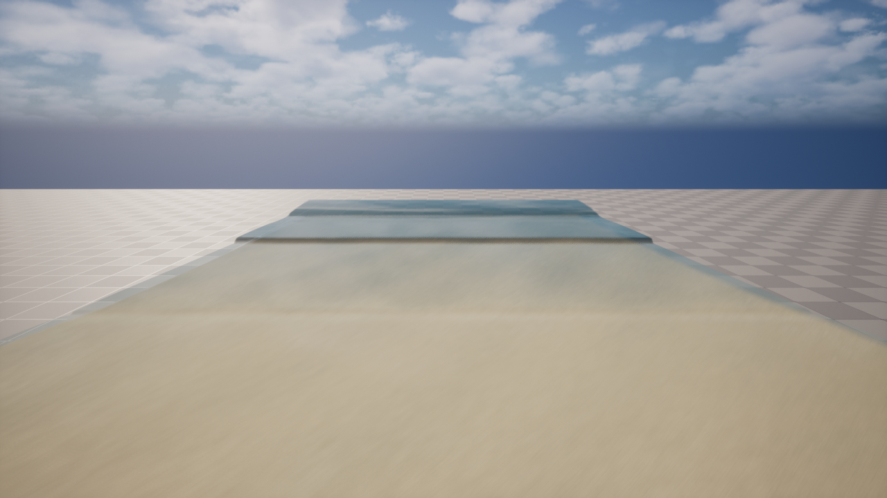
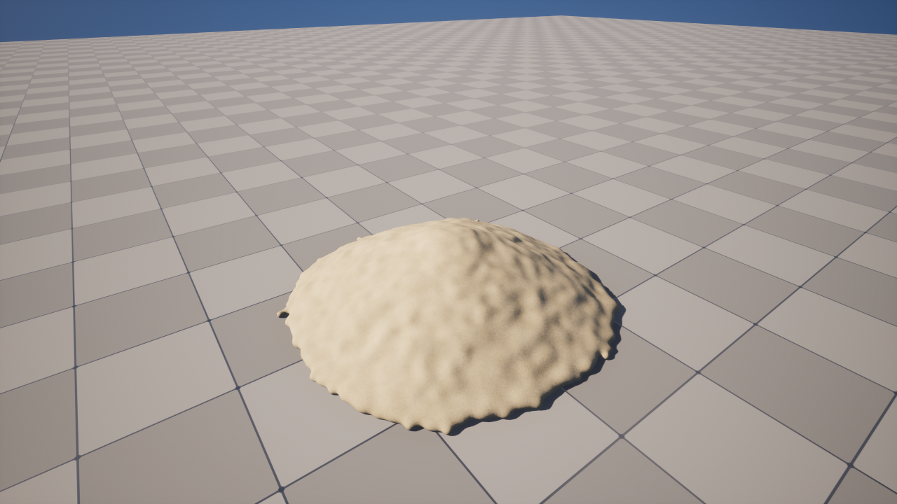

# Bay: 실시간 GPU 해변 시뮬레이션

**AI가 낸 결과를 그대로 받지 않고, 근거와 측정을 요구하며 GPU 시뮬레이션을 배워 나간 개인 프로젝트입니다.**

Unreal Engine 5.8에서 파도와 모래를 GPU로 계산합니다. 최종 목표는 직접 쌓은 모래성을 파도가 무너뜨리는 게임이며, 그 연결(M4)은 아직 구현하지 않았습니다. 지금은 기술 데모 단계입니다.

| 파도와 해변 | 입자 모래 |
|---|---|
|  |  |

<!-- [영상 링크] 60초 영상 녹화 후 여기에 추가 -->
[GitHub 저장소](https://github.com/khb7/Bay)

## 핵심 수치

| 항목 | 결과 | 조건 |
|---|---|---|
| 파도 시뮬레이션 프레임 | 13.2 → **3.49 ms** | 화면 없는 측정, 물리 통계 변화 없음 |
| 게임 화면 프레임 | 17.94 → **8.42 ms** | 1280×720, 모래 끔 |
| 입자 사출 버그 | 최대 3156 cm/s → **대조군의 1/5~1/50** | 5만 입자, 드문 꼬리는 남음 |
| 경험식 검증 (Stockdon 2006 대비) | setup 1.02, R2% 0.89, S_inc **0.55** | S_inc 부족과 쇄파 소산 부족은 미해결 |

## 어떻게 배워 나갔나

| 시기 | 사례 | 무엇이 바뀌었나 |
|---|---|---|
| 9월 | [가짜 통과였던 안식각](case-03-false-pass.md) | 통과로 나온 숫자도 조건을 바꿔 다시 재게 됨 |
| 10월 | [입자 사출 버그](case-02-particle-ejection.md) | 찍어서 고치기를 멈추고, 재현과 계측을 먼저 하는 절차를 요구함 |
| 11월 | [프레임 최적화](case-01-frame-optimization.md) | 패스별 측정으로 병목을 찾아 3.8배 개선하고, 단계마다 물리 불변을 검증함 |

## AI와 일한 방식

이 프로젝트는 AI(Claude Code)와 함께 만들었고, 구현과 실행의 많은 부분을 AI가 맡았습니다. 저는 방향과 근거를 맡았습니다. 값마다 "어디서 나온 근거인가"를 물었고, 논문 조사를 먼저 하게 했으며, 작업의 범위와 종료를 결정했습니다.

<!-- [직접 확인] 실제 역할 분담과 맞는지 확인하고, 본인 말로 고칠 것 -->

## 기록

2026년 9월부터 약 2개월의 작업이 커밋 261개와 [실행 기록](../design/m3-log.md), [논문 조사](../research/papers.md), [세션 기록](../sessions/README.md)으로 남아 있습니다. 실패한 실행과 뒤집은 판정도 지우지 않았습니다.
