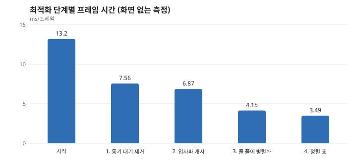

# 사례 ① 측정이 짐작을 고친 프레임 최적화

> **13.2 → 3.49 ms/프레임 (3.8배), 물리 통계 변화 없음.** 파도 시뮬레이션을 화면 없이 측정한 값입니다.

## 문제

파도 시뮬레이션은 두 격자를 GPU에서 계산합니다. 프레임당 13.2 ms가 걸려 렌더링과 모래까지 넣을 여유가 부족했습니다.

| 격자 | 칸 수 | 방정식 |
|---|---|---|
| 바깥 25 cm | 837×51 | Boussinesq (분산 포함) |
| 안쪽 5 cm | 672×256 | 얕은 물 방정식 |

처음에는 칸 수가 많은 안쪽 격자가 병목일 것이라고 생각하기 쉬운 구조였습니다.
<!-- [직접 확인] 당시 실제로 어디를 의심했는지 본인 기억으로 고칠 것 -->

## 측정으로 알게 된 것

먼저 진단과 다운로드를 끈 순수 계산 시간을 재고(`-puretime`), Unreal Insights로 패스별 GPU 시간을 나눴습니다.

- **GPU가 일하는 시간은 7.8 ms뿐이었습니다.** 나머지 약 5.4 ms는 CPU가 격자마다 GPU 완료를 기다리는 시간이었습니다.
- **칸이 4배 적은 바깥 격자가 더 느렸습니다.** 바깥 5.32 ms, 안쪽 2.48 ms로, 칸당 비용이 약 15배였습니다.
- **대칭이어야 할 패스가 비대칭이었습니다.** `FaceXCS`가 `FaceYCS`의 18배였고, 원인은 경계 칸에만 몰린 입사파 합산(528 성분)으로 추정했습니다.

## 변경과 결과

| 단계 | 병목 | 변경 | 프레임 |
|---|---|---|---|
| 시작 | | | 13.2 ms |
| 1 | 격자마다 동기 대기 | readback 링으로 비동기화 | 7.56 ms |
| 2 | 경계 칸의 입사파 합산 | 패스 앞에서 한 번 계산해 캐시 | 6.87 ms |
| 3 | 긴 줄을 스레드 하나가 직렬 풀이, 짧은 줄에 1024 스레드 그룹 | 줄 하나를 그룹 하나로 묶는 PCR, 64 스레드 변형 | 4.15 ms |
| 4 | 물가 칸 수면 계산의 이분법 | 표본을 미리 정렬한 표로 정확한 근 계산 | **3.49 ms** |

## 틀렸던 것과 배운 것

**비동기화가 새 버그를 만들었습니다.** 대기를 없애자 CPU가 GPU보다 수백 프레임 앞서 나가 임시 버퍼가 쌓였고, `E_OUTOFMEMORY`로 실패했습니다. 링이 차면 가장 오래된 readback을 기다리게 해서 CPU가 앞서는 폭을 최대 3프레임으로 제한했습니다. 동기 대기는 비용이기도 했지만 CPU를 묶어 두는 역압 역할도 하고 있었습니다.

**더 빠른 수렴이 답이 아니었습니다.** `LevelCS`가 안쪽 서브스텝의 약 50%를 차지해 이분법을 Newton으로 바꿨지만 안쪽 GPU 시간은 2.34 → 2.06 ms에 그쳤습니다. 꺾임이 많은 칸 하나가 워프 전체를 붙잡았기 때문입니다. 반복을 1회로 자른 실험으로 하한이 약 1.41 ms임을 확인했고, 칸별 반복 횟수의 편차를 없애는 정렬 표를 택해 1.43 ms까지 내렸습니다. GPU에서는 평균 반복 수보다 가장 느린 칸이 비용을 정한다는 점을 배웠습니다.

**최적화의 전제는 나중에 깨졌습니다.** 정렬 표(안쪽 44 MB)는 바닥이 고정이라는 전제로 만들었습니다. 이후 부유사를 켜자 거의 모든 칸의 바닥이 매 서브스텝 바뀌어 재정렬이 몰렸고, `DXGI_ERROR_DEVICE_HUNG`이 재현되었습니다. 쌓인 변화량이 0.1 mm 이상일 때만 정렬하도록 고쳤고, 소류사 결과가 변하지 않는지 다시 측정했습니다.

## 어떻게 검증했나

최적화가 물리를 바꾸지 않았는지 단계마다 900초 실행으로 확인했습니다. 네 단계 모두 파도 통계 4종이 소수 둘째 자리까지 같았고(setup 1.01, S_inc 0.63, S_IG 0.92, R2% 0.90), 측정 실행 시간은 533 s에서 307 s로 줄었습니다.

## 한계

- 이 수치는 화면 없는 측정입니다. 게임 화면 기준 개선(17.94 → 8.42 ms)은 별도 작업입니다.
- 서브스텝 수는 1~3프레임 늦은 최대 파속으로 정합니다.
- 입사파 캐시와 PCR 변형의 절감 원인 중 일부는 패스 비중으로 추정한 것이며, 직접 분리해 재지는 않았습니다.

## 근거

- 측정 기록: [m3-log #30~#35](../design/m3-log.md), [#38](../design/m3-log.md)
- 계획: [m3-plan p1~p4](../design/m3-plan.md)
- 코드: [SandGrid.usf](../../BeachSimulator/Shaders/Private/SandGrid.usf) (`LevelCS`, `SolveCS`, `EddyCS`)

<!--
공개 전 직접 채울 것
- 측정 GPU와 환경 (m1-result에는 RTX 4060 Ti로 적혀 있으나 M3 측정 환경은 기록에서 확인하지 못함)
- 내가 직접 내린 판단: 예) 어떤 병목부터 잡을지, 정렬 표의 44 MB를 받아들인 이유
- AI와 어떻게 나눠 일했는지 한두 문장
-->
