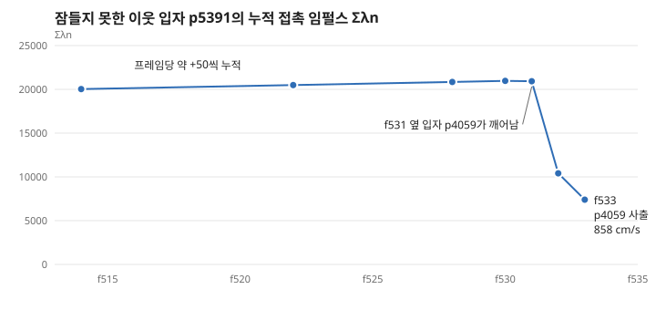

# 사례 ② 찍어서 고치기를 멈추고 절차를 세운 버그 추적

> **입자가 최대 3156 cm/s로 튀던 버그의 원인을 계측으로 찾아, 사출을 대조군의 1/5~1/50로 줄였습니다.** 전환점은 AI에게 "이걸 꼭 풀어야 하나, 풀 거면 논문 쓰듯 절차를 세우자"고 요구한 순간이었습니다.

## 문제

성능을 위해 멈춘 모래 입자를 재우는 기능(`-sleep`)을 넣자, 5만 입자 더미에서 입자가 갑자기 튀었습니다.

AI와 함께 수정을 네다섯 번 시도했습니다. 깨우기 조건, 속도 상한, 탐색 여유, 조합 전환을 차례로 바꿨지만 증상은 조금 줄거나 다른 조건에서 다시 나왔습니다. 조사 문서에는 당시 방식을 "짐작으로 고치고 결과를 보는 식이라 다섯 번 빗나갔다"고 기록했습니다.

## 방향을 바꾼 질문

당시 제가 AI에게 보낸 메시지입니다.

> "이거 무조건 해결해야 하는 부분인가? 그렇다고 하면 논문쓰듯이 좀 절차 확실하게 해서 가는거고"

> "절차대로 따로 하기 위해서 그럼 문서 하나 정리해보자 그 문서대로 다른 대화에서 진행해볼께"

이 요구로 [조사 문서](../design/m0b-investigation-wall-ejection.md)를 먼저 만들었고, 다음 규칙을 정했습니다.

1. 재현 장면과 재현 확률을 먼저 확보한다.
2. 판정 기준은 결과를 보기 전에 정하고 바꾸지 않는다.
3. 가설마다 "맞다면 계측에서 무엇이 보여야 하는가"를 먼저 적는다.
4. 계측으로 가설을 거른 뒤에만 수정한다.
5. 한 실험에는 변수 하나와 대조군을 둔다.

## 절차가 드러낸 것

**재현과 대조군:** 5만 입자에서 6/6 재현되었습니다. 판정선 50 cm/s는 대조군도 넘었지만, 기준을 바꾸지 않고 "장면 잡음은 50~120 cm/s, 문제 조합은 10~30배"로 기록했습니다.

**계측:** 입자별 링 버퍼(`-trace`)로 사출 직전 이력을 보니 처음 생각과 달랐습니다.

- "벽 근처 사출"이라는 이름부터 틀렸습니다. 사출은 벽에서 8~16R 떨어진 바닥층에서 시작했고, 벽 근처 위치는 이미 날아간 뒤의 위치였습니다.
- 겹침은 0.00~0.02R로 거의 없었습니다. 대신 깨어 있는 이웃 입자의 누적 접촉 임펄스(Σλn)가 20034에서 20966까지 프레임당 약 50씩 늘었습니다. 다른 이웃은 300~3000 수준이었습니다.
- 옆 입자가 깨어나자 이 값이 급감했고, 2프레임 뒤 858 cm/s 사출이 나왔습니다.

**원인(λ 래칫):** 처음 가설 8개에 없던 원인입니다. 잠든 입자는 질량이 무한대처럼 동작하므로, 그 사이에 낀 깬 입자의 접촉 λ가 풀리지 않고 쌓입니다. 이웃이 깨는 순간 쌓인 임펄스가 한 번에 풀립니다.

## 수정과 기각

| 수정 | 결과 | 판정 |
|---|---|---|
| 깰 때 λ를 0으로 (`-wakezero`) | 6회 중 2회 깨끗 | 부분 효과: 깨기 전까지 계속 쌓임 |
| 한쪽만 잠든 쌍은 워밍 안 함 | 사출 126~433 | **기각:** 잠든 비율이 2~9%로 무너져 줄어든 것처럼 보였을 뿐 |
| 쌓인 λ가 잠들 때의 k배를 넘으면 깨움 | k 1.2에서 재현 장면 3156 → 84 | **채택:** 잠든 비율 95% 유지 |

두 번째 수정은 사출 수치만 보면 성공처럼 보였지만, 미리 정한 "잠 유지" 기준이 걸러 냈습니다.

## 결과와 한계

- **사출:** 대조군(1279~3156 cm/s)의 1/5~1/50, 다수 실행이 잡음 범위입니다.
- **성능:** 5만 입자 정지 상태에서 10.5~12.6 ms(재우기 끔 14~16 ms)입니다.
- **남은 꼬리:** GPU 비결정성 때문에 가끔 200~575 cm/s 사출이 나옵니다.
- **부작용:** 더미 안식각이 시드에 따라 최대 −1° 달라집니다.

완전히 없애지는 못했습니다. 드문 꼬리는 알려진 한계로 두고 조사를 닫기로 제가 결정했고, 재우기는 기본 꺼짐의 선택 사항으로 남겼습니다.

## 배운 것

- AI가 수정안을 빠르게 내놓을수록 시도가 늘 뿐 이해는 늘지 않을 수 있습니다. 속도를 늦추는 절차는 사람이 요구해야 했습니다.
- 수치 하나의 개선은 다른 기준과 함께 봐야 합니다.
- "끝까지 풀 것인가"도 엔지니어링 판단입니다.

## 내 역할과 AI의 역할

- **제가 한 일:** 절차 요구, 근거 질문, 작업 범위와 종료 결정
- **AI가 많이 한 일:** 구현, 계측 코드, 실행, 로그 분석과 가설 제시

## 근거

- [조사 문서](../design/m0b-investigation-wall-ejection.md), [실행 기록 #55~#57](../design/m0-log.md), [M0-b 결과](../design/m0b-result.md)
- 커밋: `71af4d2`(절차서), `dbf4165`(계측과 H9), `30a2936`(k=1.2), `5ecb116`(종료)

<!--
공개 전 직접 확인할 것
- 인용문은 2026-10-25 대화 기록에서 그대로 옮겼음. 말투를 다듬을지 결정
- "내 역할과 AI의 역할"은 대화 기록과 문서로 추정한 것. 실제와 맞게 고칠 것
- λ 래칫, 워밍 스타트, 무한 질량을 자료 없이 말로 설명할 수 있는지 확인
-->
