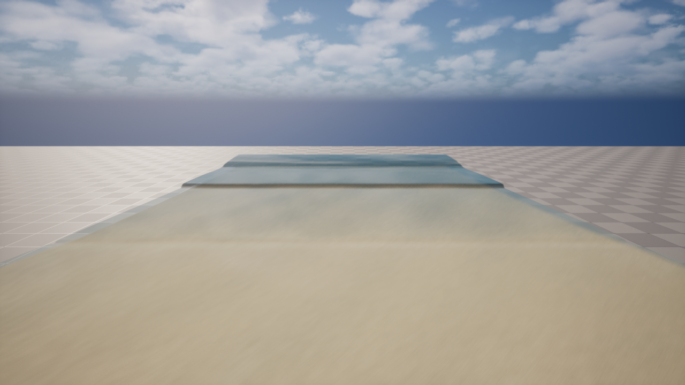
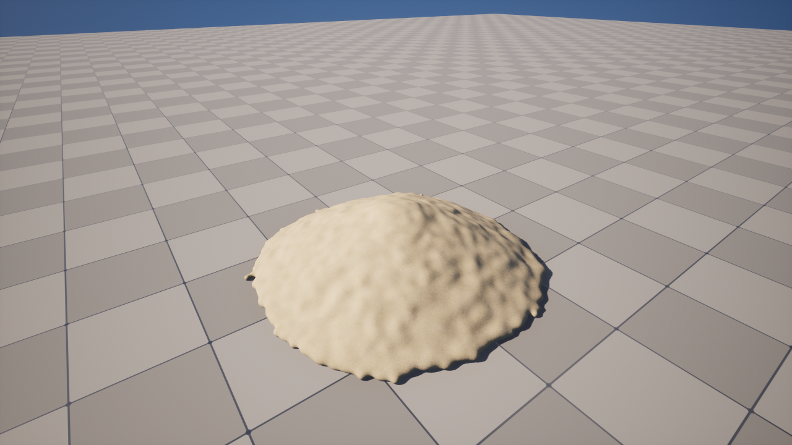

# Bay — 파도치는 모래사장 시뮬레이션

**Unreal Engine 5.8 에서 파도와 모래를 GPU 로 실시간 계산하는 개인 프로젝트입니다.** 최종 목표는 직접 모래성을 쌓고, 밀려온 파도가 그 성을 무너뜨리는 게임입니다.

| 파도와 해변 | 입자 모래 |
|---|---|
|  |  |

> 개발 중입니다. 위 화면은 지형과 재질을 시험하는 단계의 모습이고, 파도가 모래성을 무너뜨리는 부분은 아직 없습니다.

## 무엇이 다른가

- **그럴듯함보다 측정값.** 파도는 경험식과 실험 자료로 검증합니다. 모양을 맞추려고 측정값에 계수를 맞추지 않고, 계수는 문헌에서 가져옵니다.
- **두 계층의 모래.** 넓은 해변은 격자로, 손으로 만지는 모래성은 입자로 계산합니다. 터널과 아치, 덩어리 붕괴를 표현하려면 입자가 필요하기 때문입니다.
- **결정의 기록.** 설계 결정은 논문 조사 → 계획 → 구현 순서로 진행합니다. 실패한 실행과 뒤집은 판정까지 모두 문서에 남깁니다.

## 현재 구현

### 파도 (GPU 격자)

- **유체:** KP07 중심-풍상 기법의 얕은 물 방정식. 물가의 젖고 마름을 처리합니다.
- **두 격자 연결:** 바깥 25 cm 격자(분산 포함)의 파도를 안쪽 5 cm 격자(672×256)로 넘깁니다.
- **파랑:** 너울 + 풍파 이봉 스펙트럼, 방향 분산, 장주기파.
- **쇄파와 지하수:** 와점성 쇄파 모델, swash 구역 마찰, 모래 속 지하수 침투.

### 모래 지형

- **소류사:** Meyer-Peter–Müller 식과 Exner 식으로 바닥이 실제로 변합니다.
- **사태:** 기울기 한계(마름 1.0, 젖음 0.3)를 넘으면 무너집니다.
- **부유사 (옵션, `-sus`):** 평형 농도와 적응 시간을 쓰는 XBeach 방식입니다.

### 입자 모래

- **시뮬레이션:** GPU XPBD와 수분에 따른 점착.
- **표면:** 입자를 컴퓨트 셰이더로 메시화하고 같은 프레임에 그립니다. 젖은 모래의 색과 광택도 반영합니다.
- **도구:** 파기, 쌓기, 물붓기.

## 측정 결과

파도 조건은 먼바다 파고 1 m, 주기 12 s, 경사 1:15, 900초 실행입니다. Stockdon 2006 경험식 대비 비율로, 1.00이면 일치입니다.

| | setup | S_inc | S_IG | R2% |
|---|---|---|---|---|
| 바닥 고정 | 1.01 | 0.63 | 0.92 | 0.90 |
| 모래 이동 (소류사) | 1.02 | 0.55 | 0.88 | 0.89 |

- **처오름과 setup**은 기준에 가깝습니다.
- **입사파 대역 swash (S_inc)** 는 아직 기준의 55–63 %로 낮습니다.
- **처오름 2 % 값 (R2%)** 은 경험식 자체의 산포 안에서 보아야 하는 값입니다.

| 성능 (1280×720) | |
|---|---|
| 프레임 (게임 화면, 파도 전체) | 8.42 ms |
| 파도 격자 계산 (안쪽 GPU) | 약 1.4 ms |

작업 전 13.2 ms였던 시뮬레이션 프레임을 3.49 ms까지 줄였고(화면 없는 측정), 렌더 경로를 GPU로 옮겨 게임 화면의 프레임을 17.94 ms에서 8.42 ms로 줄였습니다.

## 실행

Unreal Engine 5.8 과 Visual Studio C++ 도구가 필요합니다. `BeachSimulator/BeachSimulator.uproject` 를 빌드한 뒤 실행합니다.

```bash
UnrealEditor.exe BeachSimulator/BeachSimulator.uproject -game -sandwaves -nest
```

- **조작:** WASD · QE 이동, Shift 빠르게, 가운데 버튼 끌기로 둘러보기
- **모래 지형 켜기:** `-morph`, 부유사까지 `-morph -sus`

화면 없이 파도를 측정하고 분석하려면:

```bash
UnrealEditor-Cmd.exe BeachSimulator/BeachSimulator.uproject -run=SpikeSweep -gridwaves -nest -wavesecs=900 -wavetag=test -AllowCommandletRendering
```

```bash
py Docs/research/tools_waves.py BeachSimulator/Saved/MeshRuns/waves_test.csv
```

## 로드맵

| 단계 | 내용 | 상태 |
|---|---|---|
| M0 | 입자 모래성이 서는가 | 완료 |
| M1 | 입자 → 메시, 모래처럼 보이는가 | 진행 (주요 항목 확인) |
| M2 | 도구 3종 — 파기, 쌓기, 물붓기 | 구현, 손맛 판정 남음 |
| M3 | 파도와 해변 지형 | T6 도구 연결 남음 |
| M4 | **입자 ↔ 격자 연결 — 파도가 성을 부순다** | 다음 큰 단계 |
| M5–M8 | 조석·증발, 나머지 도구, 지형 프리셋, 렌더링 마감 | 예정 |

## 문서

- [구현 순서와 검증 기준](Docs/design/milestones.md) · [시스템 설계](Docs/design/system-design.md)
- [M3 계획](Docs/design/m3-plan.md) · [M3 실행 기록](Docs/design/m3-log.md)
- [논문 조사](Docs/research/papers.md) · [용어집](Docs/research/glossary.md)
